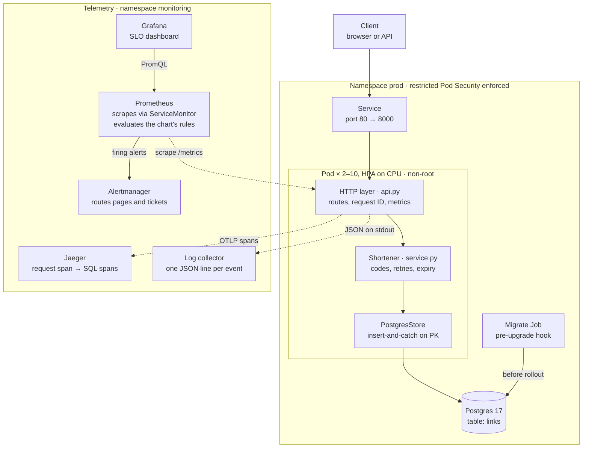
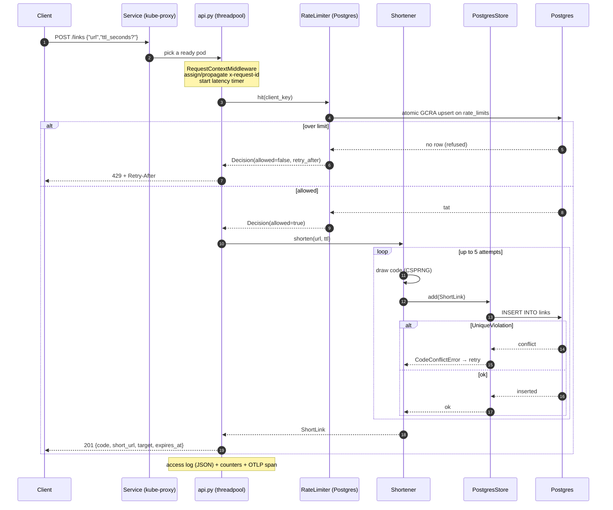
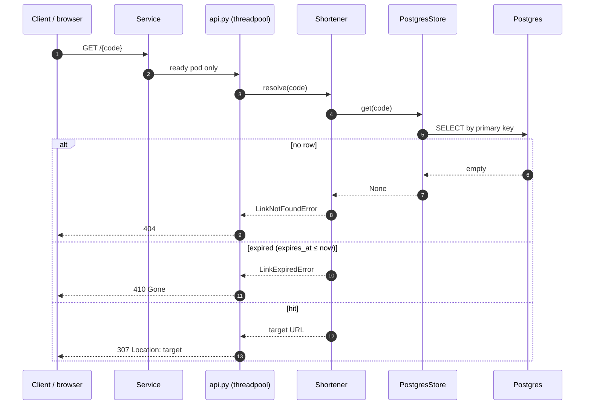
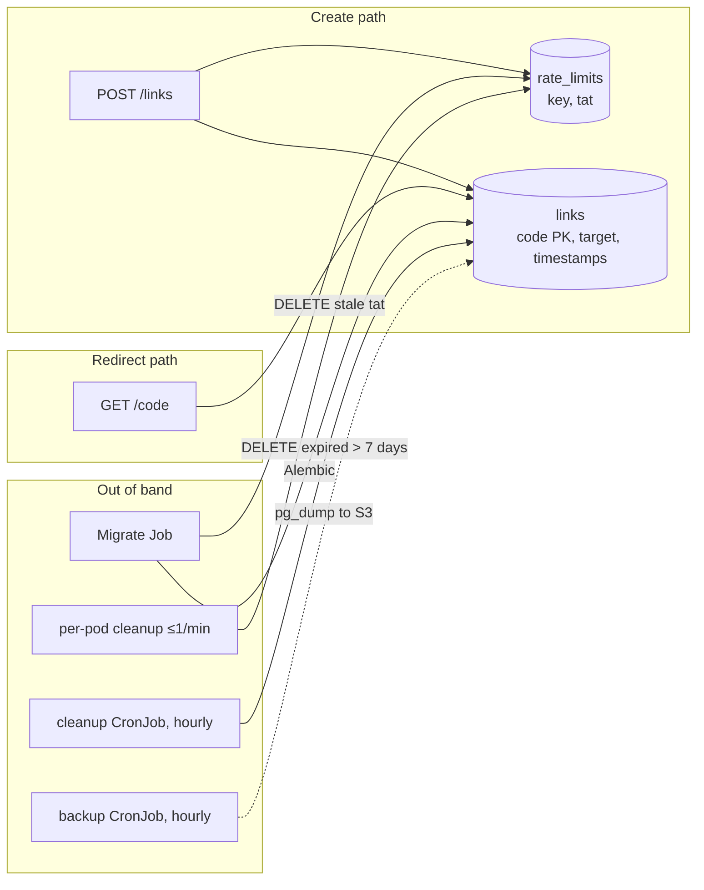
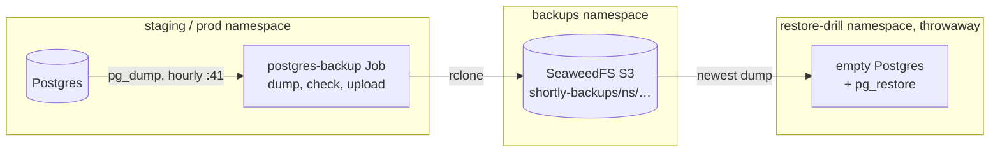
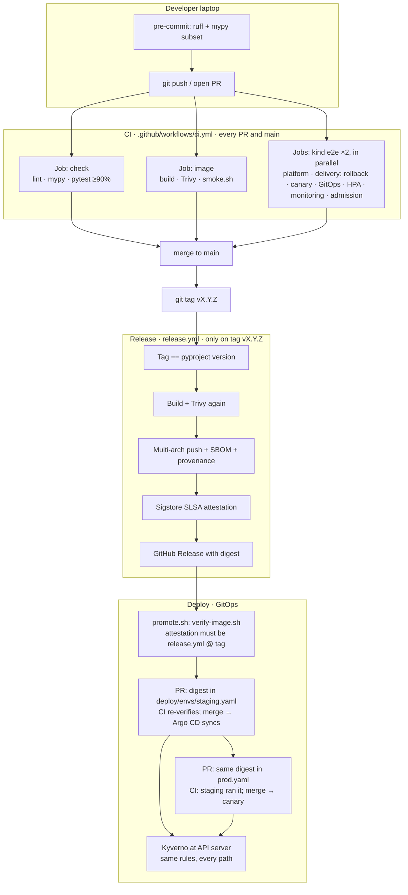
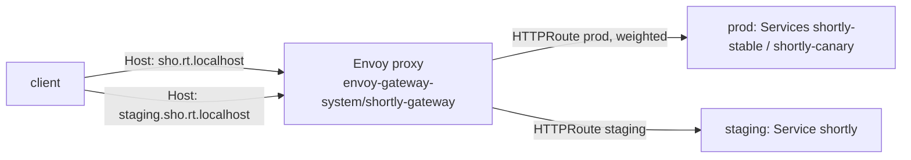
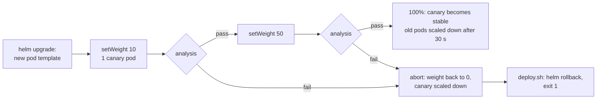
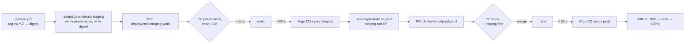
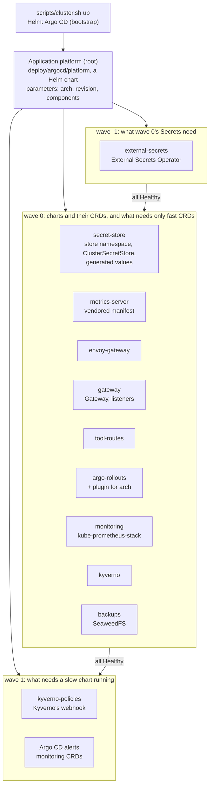

# shortly — Design Document

> Last updated 2026-10-23 for v0.7.1 / chart 0.10.0. Mirrored at
> [Claude Docs](https://claude.ai/artifact/1du93suG9M2oJJUvvQzYmS). Update both in the
> same PR as the change they describe (see `CLAUDE.md`).

> **Platform files live in [easypeasyops/platform](https://github.com/easypeasyops/platform)**
> (platform plan 3.4). Paths below under `deploy/argocd/platform`, `deploy/kind/`,
> `deploy/platform/`, `deploy/policies/`, `scripts/cluster.sh`, `scripts/lib/namespaces.sh` and
> `scripts/verify-image.sh` (the deploy gate) are in that repo, at the commit `platform.lock` names; so are the tests that check them.
> Run `cluster.sh` from a platform checkout beside this one (`../platform/scripts/cluster.sh`).

## Overview

shortly is a URL shortener: `POST /links` returns a 7-character code, and `GET /{code}` redirects to the target with a 307. It is built as a production-shaped reference service, so the operational machinery around it (CI, supply chain, observability, deploys, rollback) matters as much as the feature.

**Status:** v0.7.1 released 2026-10-23 as `ghcr.io/statsguy/shortly@sha256:f8e4982b3a41…` (amd64 + arm64), with signed SLSA provenance (previous: v0.7.0, 2026-10-22). It deploys to local Kubernetes (kind) in `staging` and `prod` namespaces.

**Goals**

- Correct, unguessable short links with optional expiry.
- Every change gated by CI: lint, strict types, tests against real Postgres, image scan, container smoke test, Kubernetes deploy and rollback drill.
- Verifiable artifacts: an image is identified by digest and traceable to a commit, tag and workflow.
- Zero-downtime rollouts with automatic rollback, rehearsed on every PR.
- Logs, metrics and traces that link to each other.

**Non-goals (for now)**

- Custom aliases, link editing or deletion, user accounts, analytics dashboards.
- Multi-region or a managed cloud deployment (the chart is portable; the infrastructure is not built yet).
- Abuse prevention (rate limiting, malicious-URL screening).

**Scope of this doc:** the system as of v0.7.1 (chart 0.10.0): the capacity work (autocommit, load shedding, HPA), SLOs with burn-rate alerts delivered through kube-prometheus-stack, the provenance gate and admission policy, per-client rate limiting, the metrics port with network policies, expired-link cleanup, overload protection (a concurrency limit and database timeouts), Postgres backups with a restore drill, the Gateway API front door, drill-only fault injection, canary releases for prod with Argo Rollouts, and GitOps with Argo CD. Operational procedures live in [RUNBOOK.md](RUNBOOK.md).

## Architecture

A request enters through the Kubernetes Service, crosses three in-process layers, and ends in one Postgres primary-key operation; logs, metrics and traces leave the pod on separate paths.



The layers depend inward only: `api.py` knows the `Shortener`, which knows the `LinkStore` Protocol, never Postgres. `PostgresStore` and `InMemoryStore` are interchangeable adapters that pass the same contract test suite. The migration Job runs from the same image before new pods start.

## Request data flow

Two paths matter for understanding the system: **create** (`POST /links`) and **redirect** (`GET /{code}`). Everything else (probes, metrics, migrations) exists to keep those paths safe under failure and load. The diagrams below show what runs on each hop and *why that hop is there*.

### Create: `POST /links`



| Step | What happens | Why it is needed |
| --- | --- | --- |
| Service → pod | kube-proxy load-balances across ready endpoints | Clients never pin a pod; a dying pod is dropped from endpoints without the client knowing |
| Request ID middleware | Propagate or mint `x-request-id`; record route template and latency | One ID ties the access log, the trace, and a support ticket; the route template keeps metric cardinality bounded |
| Rate limit before write | One Postgres upsert of GCRA state keyed by client IP (/64 for IPv6) | Creates write forever and can mask abuse; shared state means two pods cannot each grant a full burst |
| Validate URL once | `HttpUrl` before any insert retry | Reject `javascript:` / bad TTL without burning collision attempts |
| Insert-and-catch | `INSERT`; only `UniqueViolation` → retry with a new code | A check-then-insert would race under concurrency; the PK is the atomic decision |
| Build `short_url` from config | `base_url + "/" + code` | The request `Host` header is attacker-controlled; never trust it for the returned link |
| Telemetry on the way out | Counters, JSON log, optional span | Operators see volume, collisions, and 429s without reading the DB |

**Side paths that do not run on create, but protect it:**

- **Pool timeout → 503.** If all five connections are busy for `pool_timeout` (1 s), the store raises `StoreBusyError` and the API returns 503 with `Retry-After: 1`. Without this, a slow DB turns into a silent queue of requests holding threads for up to 30 s.
- **Autocommit.** Each statement is already atomic in Postgres; skipping the implicit `BEGIN`/`COMMIT` removes two round trips per request (~25% more capacity on one CPU).
- **Migrate Job before new pods.** Schema expands first so old and new code can both talk to the DB during a rollout.

### Redirect: `GET /{code}`



| Step | What happens | Why it is needed |
| --- | --- | --- |
| No rate limit | Redirects are not counted against the create limiter | Reads are cheap; flooding redirects is an edge/DoS problem, not something a pod fixes by counting |
| Sync handler in threadpool | Blocking `SELECT` runs off the event loop | An `async def` with a sync driver would stall every other request on that worker |
| PK lookup only | `WHERE code = …` | No secondary index on the request path (the one index serves the cleanup job); the hot path stays one round trip (+ optional pre-ping) |
| Expiry in the app | Compare `expires_at` to the injected clock | Tests can freeze time; DB still enforces `expires_at > created_at` at write time |
| **307, not 301** | Temporary redirect | Browsers cache 301 forever, which would ignore later expiry and hide repeat clicks from any future analytics |
| Outcome metrics | `link_resolutions_total{outcome=hit\|not_found\|expired}` | 404/410 are correct answers (they do not burn the availability SLO); 5xx do |

### What a request never does

These are deliberate absences:

- **No Host-based URL construction** — prevents open-redirect style spoofing of `short_url`.
- **No check-then-insert** — prevents lost races when two pods draw the same code.
- **No DB work on `/healthz`** — a DB outage must not restart every pod (that would add a restart storm to the outage). `/readyz` takes pods out of the Service instead.
- **No `/metrics` on the public port in production** — scrapes use port 9100; NetworkPolicy admits only Prometheus. A scrape on the app port would also compete with user traffic for the threadpool.

### Data at rest (how the two tables fit)



- **`links`** is durable product state. The cleanup CronJob deletes links that expired more than 7 days ago (see Data and migrations); links without a TTL are kept forever. It is backed up hourly (see Backups and recovery).
- **`rate_limits`** is ephemeral control state. A past `tat` equals "no row"; pods delete those rows so the table stays small. Losing the table only resets every client's burst — it does not lose short links.

## Domain model and code generation

A `ShortLink` is a frozen Pydantic model, validated once at creation so the rest of the code can trust it.

| Field | Type | Invariant |
| --- | --- | --- |
| `code` | str | base62, 7 characters by default |
| `target` | `HttpUrl` | http or https only (`javascript:`, `ftp:` rejected) |
| `created_at` | aware datetime | naive datetimes rejected |
| `expires_at` | aware datetime or null | must be later than `created_at`; a link is expired at and after this instant |

**Codes** come from `secrets.choice` over `[0-9a-zA-Z]`. A code is a capability: whoever holds it can resolve the URL, so it must be unpredictable. `random` is a predictable PRNG and is banned by ruff rule S311.

**Collisions.** With N = 62⁷ ≈ 3.52 × 10¹² codes, the birthday bound gives P(collision among n) ≈ 1 − e^(−n²/2N):

| Links stored | P(at least one collision) |
| --- | --- |
| 10,000 | about 1.4 × 10⁻⁵ |
| 266,000 | about 1% |
| 2,200,000 | about 50% |

Collisions are therefore expected long before the space is full, and they are handled rather than prevented.

**Insert-and-catch, not check-then-insert.** `Shortener.shorten` draws a code and calls `store.add`; the store raises `CodeConflictError` atomically (the Postgres primary key), and the service retries with a fresh code up to 5 times, then raises `CodeSpaceExhaustedError` (HTTP 503). A `get` before `add` would race under concurrency. Only unique violations are retried; any other integrity error propagates as a bug.

**Injected nondeterminism.** The code generator and the clock are constructor arguments. Tests pass `scripted_codes("dup", "dup", "fresh")` and a `FakeClock` instead of patching globals. An `on_collision` hook feeds the `code_collisions_total` metric without the domain layer importing Prometheus.

## HTTP API

The HTTP layer only parses input, calls the service and maps outcomes to status codes; it holds no business logic. It is built by `create_app(shortener, base_url=..., metrics=..., tracer_provider=..., rate_limiter=...)`, so tests construct it with in-memory dependencies.

| Method + path | Success | Errors | Notes |
| --- | --- | --- | --- |
| `POST /links` | 201 `{code, short_url, target, expires_at}` | 422 invalid URL or TTL; **429 + `Retry-After`** over the per-client limit; 503 code space exhausted | Body `{"url": "https://…", "ttl_seconds": 1..31536000}` (TTL optional) |
| `GET /{code}` | 307, `Location: <target>` | 404 unknown; 410 expired; 503 + `Retry-After: 1` when the DB pool is exhausted | Sync endpoint: blocking DB calls run in the threadpool |
| `GET /healthz` | 200 | — | Liveness: process is responsive. Never touches the DB. `async`: answered on the event loop, never behind request work |
| `GET /readyz` | 200 | 503 when the DB ping fails | Readiness: can this pod take traffic. The ping runs on its own one-thread limiter, not the request threadpool |
| `GET /metrics` (port 9100) | 200, Prometheus text | — | On its own port (`SHORTLY_METRICS_PORT`), served from its own thread, so a scrape never waits behind requests. Only Prometheus may reach it (NetworkPolicy). The app port answers 404 |

**503 with `Retry-After: 1`** means overload, not failure. A request gets it in three cases, each counted in `load_shed_total` under its own `reason`:

| `reason` | When | Where |
| --- | --- | --- |
| `concurrency` | The pod already has `SHORTLY_MAX_CONCURRENT_REQUESTS` requests in flight | `ConcurrencyLimitMiddleware`, before any work: answered in about 1 ms |
| `pool` | No pooled connection frees up within `SHORTLY_DB_POOL_TIMEOUT_SECONDS` | The store raises `StoreBusyError` |
| `db_timeout` | Postgres cancelled a statement after `SHORTLY_DB_STATEMENT_TIMEOUT_MS`, or a lock wait after `SHORTLY_DB_LOCK_TIMEOUT_MS` | The store maps the cancel to `StoreBusyError` |

A shed request still goes through the request middleware, so it has a request ID and an access log line, and it is labelled with its route template. A shed redirect is therefore a 503 on `route="/{code}"` and burns the availability SLO: shedding protects latency, it doesn't hide failures. Probes and `/metrics` are never shed.

### Rate limiting

`POST /links` is limited per client: by default a burst of 20, then 60 per minute (`SHORTLY_RATE_LIMIT_*`). Over the limit the API answers **429** with `Retry-After` in whole seconds, rounded up so that a client which waits that long succeeds. Creates are limited because each one writes a row that lives forever and can carry abuse (masking a phishing link). Redirects are not limited: they are cheap reads, and a flood of them is a denial-of-service problem for the edge, not something a pod can fix by counting.

**Algorithm: GCRA** (generic cell rate algorithm), a token bucket stored as one number per client. That number is the theoretical arrival time `tat`: the moment the client's bucket would be full again. Each allowed request moves `tat` forward by `T = 60 / per_minute` seconds. A request is allowed if, after the move, `tat` is at most `burst × T` ahead of now. A refused request changes nothing, and its `Retry-After` is exact. Unlike a fixed-window counter, there is no window edge across which a client can double its rate, and there is no refill job.

**State in Postgres, one statement.** The single number makes the shared version one atomic upsert:

```sql
INSERT INTO rate_limits AS r (key, tat) VALUES (:key, :now + :T)
ON CONFLICT (key) DO UPDATE SET tat = GREATEST(r.tat, :now) + :T
 WHERE GREATEST(r.tat, :now) + :T - :now <= :burst_x_T
RETURNING tat              -- no row returned = refused
```

The row lock serialises concurrent requests from one client, so the limit is **exact across replicas**. A test sends 40 concurrent requests from one client through 5 connections and gets exactly the burst of 10. The e2e sends one client's creates through the prod Service, which spreads them over both pods. It requires at least the burst to succeed and at most the burst plus what refilled while it ran, then 429s; per-pod counters would let all of them through. The alternatives were weaker:

- Per-pod counters give each client N times the limit, and N changes with the HPA.
- Redis is exact too, but adds a stateful service and a new failure mode.

The cost is one extra query per create (see Capacity). The time comes from the app's clock, so tests can drive it. NTP keeps pods within milliseconds, which is noise for a limit counted in seconds. A row whose `tat` has passed means the same as no row, so each pod deletes those at most once a minute. The table holds only the clients active in the last few seconds.

**Who is a client.** The key is the peer IP after uvicorn's proxy-header handling. IPv6 is grouped by /64, because one subscriber usually holds a whole /64. `X-Forwarded-For` is believed only from `FORWARDED_ALLOW_IPS`: the chart value `config.forwardedAllowIps`, which defaults to localhost only. It must be exactly the ingress or load balancer. Anything listed there can claim to be any client; anything missing makes the proxy itself the one "client" everyone shares. In kind there is no ingress, so prod trusts the pod network (`10.244.0.0/16`, pinned in `deploy/kind/cluster.yaml`). That lets the in-cluster load generators act as many clients, each from a random address in the benchmark range 198.18.0.0/15. The local compose stack trusts its network for the same reason.

Refusals are counted in `rate_limited_total`, appear as status 429 in `http_requests_total` (a 4xx, so they never burn an SLO), and log one `rate limited` line naming the client key. That line is the only place the app logs an address, and only for refused requests. Addresses are personal data, so keep log retention short.

**307, not 301.** Browsers cache a 301 indefinitely, so an expired link would keep redirecting and future click analytics would never see repeat visits.

**Liveness vs readiness.** A database outage flips `/readyz` to 503, which removes pods from Service endpoints, while `/healthz` stays 200, so Kubernetes does not restart them. Restarting every pod during a DB outage would add a restart storm to the outage. Verified: with Postgres stopped, readiness returns 503 and liveness 200; both recover without an app restart.

**`short_url`** is built from the configured `base_url`, never from the request `Host` header, which a client controls.

Every response carries `x-request-id`. A caller-supplied ID matching `[A-Za-z0-9._-]{1,64}` is propagated; anything else is replaced with a new UUID, which prevents log injection.

## Data and migrations

Two tables, defined with SQLAlchemy Core in `src/shortly/db.py`; the database enforces the same invariants as the model.

```sql
CREATE TABLE links (
  code        VARCHAR(32) PRIMARY KEY,          -- uniqueness = atomic collision detection
  target      TEXT NOT NULL,
  created_at  TIMESTAMPTZ NOT NULL,
  expires_at  TIMESTAMPTZ NULL,
  CONSTRAINT expiry_after_creation CHECK (expires_at IS NULL OR expires_at > created_at)
);
CREATE INDEX ix_links_expires_at ON links (expires_at)
  WHERE expires_at IS NOT NULL;                  -- for the cleanup job; built CONCURRENTLY

CREATE TABLE rate_limits (    -- GCRA state (see Rate limiting); short-lived rows
  key  VARCHAR(64) PRIMARY KEY,  -- client IP, or IPv6 /64
  tat  DOUBLE PRECISION NOT NULL -- epoch seconds; a past value means "no state"
);
```

**Access path.** Writes are single-row inserts; reads are primary-key lookups. The one secondary index, `ix_links_expires_at`, serves the cleanup job. It is partial, so links without a TTL (most of them) never enter it and their inserts don't pay for it. `PostgresStore` maps only `psycopg.errors.UniqueViolation` to `CodeConflictError`.

**Connection pool.** SQLAlchemy `QueuePool` with a **fixed** size: `pool_size` from `SHORTLY_DB_POOL_SIZE` (default 5) and `max_overflow=0`, so each pod's connection count is a known number for the Postgres budget (see Capacity). `pool_timeout` comes from `SHORTLY_DB_POOL_TIMEOUT_SECONDS` (default 1 s, instead of SQLAlchemy's 30 s): a request waits at most that long for a connection and then gets a 503. `pool_pre_ping=True` means a DB restart costs a reconnect rather than one failed request per stale connection; it costs one round trip per checkout and is kept on purpose. One-shot processes (migrations) use `NullPool`.

**Autocommit.** The app's engine runs with `isolation_level="AUTOCOMMIT"`. Every query the app issues is a single statement, which Postgres already executes atomically, so the implicit `BEGIN … COMMIT/ROLLBACK` added two round trips per request for no safety gain. Removing them raised one pod's capacity by about 25% (see Capacity). An integration test checks the behaviour (a write is visible to another connection without `commit()`). A future multi-statement unit of work must opt back in explicitly with `conn.execution_options(isolation_level="READ COMMITTED")`. Migrations use their own engine and stay transactional.

**Expired-link cleanup.** A link past its expiry answers 410 Gone, but its row would stay forever. A CronJob (the `cleanup` entry of `cronJobs` in the chart's values, rendered by `templates/cronjobs.yaml`; hourly at :17) runs `python -m shortly.cleanup`, which deletes links that expired more than `SHORTLY_CLEANUP_GRACE_DAYS` ago (7). Until then, a link still answers 410 rather than 404. Deletion is designed to be harmless on a busy table:

| Property | How |
| --- | --- |
| No long locks, no huge transaction | Batches of 1,000 (`DELETE … WHERE code IN (SELECT … LIMIT n)`), each one statement that commits on its own, with a short pause between batches |
| Bounded run | At most 100 batches per run; a bigger backlog is finished by the next runs, and the log says `"complete": false` |
| Safe to overlap or to stop | `FOR UPDATE SKIP LOCKED`: a manual run during the scheduled one splits the work; a killed run keeps what it already deleted |
| Never a full table scan | The query walks the partial index; a test asserts the planner can use it for exactly this query |
| Failure is visible | No metrics to push: kube-state-metrics reports the CronJob's last success, and `ShortlyCleanupNotRunning` opens a ticket after 3 missed hours. Each run logs one JSON line (`deleted`, `batches`, `complete`, `duration_ms`) |

The Job runs the release image, so Kyverno verifies its provenance (CronJob templates are checked too), and it runs under the restricted Pod Security Standard. Its pods carry their own labels (`app.kubernetes.io/name: shortly-cleanup`), not the app's selector labels: a pod matching those would be counted by the HPA, skewing average CPU, and by the PodDisruptionBudget. A NetworkPolicy of its own lets it reach only DNS and the database. Postgres accepts `app.kubernetes.io/part-of: shortly`, which every pod of the chart carries. The label change was done expand/contract, like a schema change: chart 0.6.0 added `part-of` while Postgres still accepted the old `name` label too, and the old peer was removed once no older release ran.

**The index was built CONCURRENTLY.** A plain `CREATE INDEX` blocks every write to the table until it finishes, which on a large table is an outage. `CONCURRENTLY` cannot run in a transaction, so the migration uses Alembic's `autocommit_block()`. A concurrent build that fails leaves an *invalid* index behind, which `IF NOT EXISTS` would then silently keep, so the migration drops an invalid one before building. The e2e checks that the index is valid after the real migration Job ran.

**Migrations** are Alembic revisions in `migrations/versions/`. The database URL comes from the same `Settings` as the app. New revisions are formatted by ruff via a post-write hook.

Guards in the test suite:

- `alembic check` fails if `db.py` and the migrations drift apart.
- Every run downgrades to base and re-applies head.
- Integration tests run against a real `postgres:17-alpine` container (testcontainers), migrated with the real migrations.

**How migrations run in production.** A Helm `pre-install,pre-upgrade` hook Job runs `alembic upgrade head` from the release's own image before any new pod starts (the command is `migrations.command` in the chart's values; the chart only knows to run it first). A failed migration aborts the release while the old pods keep serving. It is one Job per release, never an initContainer per replica, which would race on the schema.

**Compatibility rule: expand, deploy, contract.** During a rollout, old pods serve against the new schema, and a rollback runs old code against it too. Every migration must therefore be backward compatible with the previous app version. Destructive changes (drop or rename a column) ship in a later release, after no running version reads the old shape.

### Backups and recovery

Losing the database loses every link, and a short link that stops resolving breaks every place it was published. So each environment's Postgres is backed up every hour, the backups live apart from the database, and a restore is proven on every PR.



| Property | How | Why |
| --- | --- | --- |
| What | `pg_dump --format=custom` of the whole database, by the server's own image | A logical dump restores into any Postgres of the same or newer major version; the server's image keeps client and server versions equal |
| Checked when taken | `pg_restore --list` on the archive before upload; the Job fails otherwise | A corrupt dump is found within the hour, not during the incident |
| Where | An S3 bucket in its own namespace (`deploy/kind/backups.yaml`); only pods labelled `component=backup` reach it (NetworkPolicy) | Backups that share the database's failure domain or credentials are lost with it. In a real cloud: another account or region, versioning and object lock |
| How often, how long | Hourly at :41; 7 days kept, deleted by the Job itself (never the newest) | Recovery point and storage cost; see RPO below |
| Proven | `scripts/restore-drill.sh`: the newest dump into an empty Postgres in a throwaway namespace; checks the Alembic revision, the link count and a canary link. e2e step 11 runs it on every PR | A backup nobody has restored is a hope. The drill also measures the restore time |
| Watched | `ShortlyBackupNotRunning` (ticket) after 2 missed runs or 2 hours without a success | Backups fail silently: nothing breaks until the day they're needed |

**Recovery objectives (local setup).**

- **RPO, the data you can lose: up to 1 hour**, the backup interval. Everything written since the last dump is gone. Continuous WAL archiving (pgBackRest, WAL-G, or a managed database's point-in-time recovery) brings it down to seconds; that is the production answer, not hourly dumps.
- **RTO, the time to restore: about 5 s** for the drill's database in CI (2,967 links, a 78 KB dump: download, empty Postgres, `pg_restore`, checks). That figure is mostly fixed overhead. Restore time grows with the database: a logical restore rebuilds every index, so a large table takes minutes to hours. Re-measure as data grows; RUNBOOK has the procedure for a real restore into prod.

## Configuration and secrets

All configuration comes from environment variables, parsed by `pydantic-settings` at startup. An invalid or missing value stops the process on boot rather than failing on the first request; the rollback drill relies on this.

In Kubernetes the list of variables is the `env` list in the chart's `values.yaml`, rendered as it is by the chart (the app's business, not the chart's: platform plan 1.3b). Each value is a template reading `config.*`, which env files and `--set` override; the drill-only and tracing-only variables carry a `when` and are left out unless switched on.

| Variable | Default | Meaning |
| --- | --- | --- |
| `SHORTLY_DATABASE_URL` | required | Postgres DSN; always from a Kubernetes Secret |
| `SHORTLY_BASE_URL` | `http://localhost:8000` | Public base for `short_url` |
| `SHORTLY_DB_POOL_SIZE` | `5` | Connections per pod (fixed, no overflow) |
| `SHORTLY_DB_POOL_TIMEOUT_SECONDS` | `1.0` | Longest wait for a pooled connection before a 503 |
| `SHORTLY_DB_STATEMENT_TIMEOUT_MS` / `SHORTLY_DB_LOCK_TIMEOUT_MS` | `2000` / `1000` | Postgres cancels a statement running, or a lock wait lasting, longer than this; the request gets a 503. `0` = off. Migrations have none; the cleanup Job uses 30 s |
| `SHORTLY_MAX_CONCURRENT_REQUESTS` | `16` | Requests one pod works on at once; more get a 503 at once (see Capacity). `0` = no limit |
| `SHORTLY_FAULT_ERROR_RATIO` | `0` | **Drills only.** This share (0–1) of creates and redirects fails with 500 while probes pass: a release that is ready but broken. Logged as a warning at start; counted in `faults_injected_total`; `ShortlyFaultInjectionOn` opens a ticket if it stays on |
| `SHORTLY_RATE_LIMIT_CREATES_PER_MINUTE` | `60` | Sustained `POST /links` rate per client; `0` turns limiting off |
| `SHORTLY_RATE_LIMIT_BURST` | `20` | Creates a quiet client may make at once |
| `SHORTLY_CLEANUP_GRACE_DAYS` | `7` | Cleanup keeps links that expired less than this long ago (they still answer 410) |
| `SHORTLY_CLEANUP_BATCH_SIZE` / `SHORTLY_CLEANUP_MAX_BATCHES` | `1000` / `100` | Rows per delete statement, and statements per run |
| `SHORTLY_METRICS_PORT` | `9100` | Port for `/metrics`, served by its own thread; `0` serves it on the app port instead (tests, local runs) |
| `FORWARDED_ALLOW_IPS` | `127.0.0.1` | Read by uvicorn: peers whose `X-Forwarded-For` is believed. Must be exactly the ingress |
| `SHORTLY_LOG_LEVEL` | `INFO` | One of DEBUG, INFO, WARNING, ERROR |
| `SHORTLY_LOG_JSON` | `true` | `false` for human-readable local logs |
| `SHORTLY_SERVICE_NAME` | `shortly` | `service.name` on traces |
| `OTEL_EXPORTER_OTLP_ENDPOINT` | unset | Tracing is on only when set; other `OTEL_*` vars are honoured |

**Secrets** never appear in values files or the repo. The chart reads the DB URL from `database.existingSecret` (default `shortly-db`, key `url`). Locally, `scripts/cluster.sh` generates a random 32-character password per namespace; in a real cluster the Secret would come from a secret manager (External Secrets, Vault, Sealed Secrets). `.env` is git-ignored; `.env.example` is the committed template. The Docker build context is an allow-list (`.dockerignore`), so `.env` cannot reach an image layer.

## Observability

The three signals point at each other: a log line carries the request ID and trace ID, a trace contains the SQL that ran, and metrics are labelled by the same route template the logs and traces use.

**Logs.** One JSON object per line on stdout (the platform collects it; the root filesystem is read-only). uvicorn and SQLAlchemy logs are routed through the same formatter. An access line is written per request by a pure-ASGI middleware:

```json
{"ts": "2026-10-21T04:30:16.343+00:00", "level": "info", "logger": "shortly.access", "msg": "request", "request_id": "d0853a21…", "trace_id": "bb2a4793…", "span_id": "588f9536…", "method": "GET", "route": "/{code}", "status": 404, "duration_ms": 2.51}
```

Probe and scrape requests (`/healthz`, `/readyz`, `/metrics`) log at DEBUG so they don't drown real traffic.

**Metrics** (Prometheus, per-app registry):

| Metric | Type | Labels | Answers |
| --- | --- | --- | --- |
| `http_requests_total` | counter | method, route, status | Traffic and error rate |
| `http_request_duration_seconds` | histogram | method, route | Latency; buckets 5 ms to 2.5 s around a 50 ms redirect target |
| `links_created_total` | counter | — | Write volume |
| `link_resolutions_total` | counter | outcome = hit, not_found, expired | Redirect outcomes |
| `code_collisions_total` | counter | — | A rising rate means codes need to get longer |
| `db_pool_size` | gauge | — | Configured connections per pod |
| `db_pool_in_use` | gauge | — | Connections checked out now; near `db_pool_size` means the pool is the bottleneck |
| `load_shed_total` | counter | reason = concurrency, pool, db_timeout | Requests rejected with 503 because the pod or the database was saturated |
| `requests_in_flight` | gauge | — | Requests the pod is working on now (probes excluded); at `SHORTLY_MAX_CONCURRENT_REQUESTS`, it sheds |
| `faults_injected_total` | counter | — | Requests failed on purpose by fault injection (drills). Must be 0 outside a drill |
| `rate_limited_total` | counter | — | `POST /links` refused with 429: the client was over its limit. No client label: one series per address would be unbounded |

**Cardinality rule.** The `route` label is the route template (`/{code}`), never the raw path. Raw paths would create one time series per link ever made. A test asserts that 50 distinct codes produce one series; unmatched paths share `route="unmatched"`.

**Traces** (OpenTelemetry, OTLP/HTTP) are enabled only when `OTEL_EXPORTER_OTLP_ENDPOINT` is set. FastAPI instrumentation creates the server span (probes excluded; per-ASGI-message send/receive spans excluded, which cut span volume about 3×). Database spans come from **psycopg driver** instrumentation. The SQLAlchemy instrumentation was tried first and silently did nothing: it supports SQLAlchemy < 2.1 and we run 2.1.4. An integration test now fails if SQL spans stop appearing in the request's trace. Buffered spans are flushed on shutdown.

## SLOs and alerting

Four SLOs say what users can expect from shortly. Alerts fire when the error budget is being spent too fast, not whenever a metric looks unusual.

| SLO | SLI (good events ÷ valid events) | Objective, 30 days | Budget |
| --- | --- | --- | --- |
| `redirect-availability` | `GET /{code}` responses that are not 5xx | 99.9% | 0.1%: about 43 minutes of full outage |
| `redirect-latency` | `GET /{code}` responses faster than 50 ms | 99% | 1% |
| `create-availability` | `POST /links` responses that are not 5xx | 99.5% | 0.5% |
| `create-latency` | `POST /links` responses faster than 100 ms | 99% | 1% |

**What counts as good.** 404 (unknown link) and 410 (expired) are correct answers, so they are good events. Every 5xx is bad, including the 503 from load shedding: the user did not get an answer. The redirect latency target is the load test's gate (p99 < 50 ms). Redirects get the stricter objectives because every click depends on them, while a failed create can be retried by its caller.

**Source of truth.** The SLOs are declared in `deploy/prometheus/slos.yaml`. `scripts/gen_slo_rules.py` turns that file into Prometheus rules in `deploy/prometheus/rules/slo.yaml`, which is committed so reviewers see the real PromQL; the platform's copy of the generator writes the same rules as a values file for the service chart (`deploy/service/slo-rules.values.yaml`, `--values`). The generator holds nothing of shortly's (platform plan 1.4): `--spec` and `--out` name an app's spec and rules file (shortly's are the defaults), and the spec's `runbook_url` is where every alert links. One gap for a second app: the SLI selectors pick series by `method` and `route` only, so two apps with the same route in one namespace would share an SLI; the spec would then need a `job` matcher. The service chart ships them, as text in shortly's values (see Delivery below); `tests/test_service_values.py` keeps the values and the rule files equal. For each SLO the generator emits:

- `slo:sli_error:ratio_rate<window>`: the error ratio over 5m, 30m, 1h, 2h, 6h, 1d, 3d and 30d.
- `slo:objective:ratio`: the target itself.
- `slo:error_budget_remaining:ratio`: the share of the 30-day budget left. A negative value means the budget is overspent.
- Two burn-rate alerts, one paging and one ticketing.

All series are per `namespace`, so staging and prod keep separate budgets.

**Burn-rate alerts** (multi-window, multi-burn-rate, from the Google SRE Workbook). The burn rate is how fast the budget is being spent; at 1x it lasts exactly 30 days. An alert fires only when a long window shows the burn is significant **and** a short window shows it is still happening. That makes it fire within minutes of a real incident, and clear once the short windows are clean again: after 5 minutes for the 14.4x pair, 30 minutes for the 6x pair.

**A minimum of bad events.** Each pair also needs at least 5 bad events in its long window (`MIN_BAD_EVENTS` in `scripts/gen_slo_rules.py`, from the recorded `slo:sli_events:increase<window>`). A ratio alone can't tell 1 slow request out of 3 in a quiet hour (33%) from 300 out of 900. Five is low enough that a real incident on a quiet service still alerts, and that a sustained tail adds up (the promtool test: 1 slow create an hour pages after 6 hours). It would not have silenced the page during the v0.7.1 canary, rightly: 7% of about 670 creates over 100 ms is a real tail (Known limitations).

| Severity | Fires when (either pair) | Budget spent by then | `for` |
| --- | --- | --- | --- |
| page | 14.4x over 1h and 5m, or 6x over 6h and 30m | 2% or 5% | 2m |
| ticket | 3x over 1d and 2h, or 1x over 3d and 6h | 10% | 15m |

**Cause-based alerts** in `deploy/prometheus/rules/shortly.yaml` (hand-written, and carried as text in `deploy/service/values.yaml`) cover what an SLO computed from the app's own metrics cannot see, or warn before the budget is spent:

| Alert | Severity | Why the SLO alerts miss it |
| --- | --- | --- |
| `ShortlyDown` | page | No pod scraped means no traffic data; every ratio is empty and no burn-rate alert can fire |
| `ShortlyNoAvailablePods` | page | One environment with zero pods produces no metrics of its own, while another environment keeps `up` non-empty; this uses kube-state-metrics |
| `ShortlyNotReady` | page | Pods out of rotation fail requests at the load balancer, which the app never counts |
| `ShortlyLoadShedding` | ticket | It burns the budget too, but this alert names the cause: one alert per `reason` (`concurrency`: traffic above what the pods serve; `pool` or `db_timeout`: a slow database) |
| `ShortlyAtMaxReplicas` | ticket | The HPA has no headroom left; uses kube-state-metrics |
| `ShortlyCleanupNotRunning` | ticket | The cleanup CronJob's last success is over 3 hours old, or it has never succeeded; uses kube-state-metrics |
| `ShortlyBackupNotRunning` | ticket | The Postgres backup CronJob's last success is over 2 hours old (2 missed hourly runs), or it has never succeeded; uses kube-state-metrics. Only where the kind backup CronJob exists |
| `ShortlyFaultInjectionOn` | ticket | Fault injection has failed requests for 15 minutes: a drill left on, or the setting leaked into a release. Drills last minutes, so they stay quiet |
| `ShortlyRateLimiting` | ticket | Over 10% of creates refused with 429 for 30 minutes: abuse, or a limit too tight for real users. 429s never burn the SLO, so without this a bad limit would be invisible |

**How the rules are kept honest** (`tests/test_alert_rules.py`, which runs in CI):

1. The committed `slo.yaml` must equal what the generator produces from `slos.yaml`.
2. promtool unit tests (`deploy/prometheus/tests/alerts_test.yaml`) feed in synthetic series. They check that each alert fires when it should and stays quiet when it shouldn't: within budget, 404s, one pod down, too early for `for`, and staging versus prod.
3. Every selector in every rule must match a sample the app actually exports, after the test has driven every outcome through the app (201, 307, 404, shed 503, readiness 503, exhausted code space). So a renamed route, metric, label or histogram bucket fails the build instead of silently disabling an alert.
4. Every `runbook_url` must point at a heading that exists in RUNBOOK.md.
5. Every query on the SLO dashboard must select something the app exports or a recorded series.

The platform's tests (`tests/test_alerting.py` there) give its own alerts on Argo CD the same promtool treatment, and use amtool to validate the Alertmanager config and check where each kind of alert is routed.

**Delivery in Kubernetes.** Argo CD installs kube-prometheus-stack 91.9.0 (pinned by digest; "The platform under Argo CD" below) into a `monitoring` namespace: Prometheus Operator, Prometheus, Alertmanager, kube-state-metrics and Grafana. Pieces that can't work in kind are disabled: control-plane scraping, and node-exporter, which needs host namespaces that the namespace's `baseline` Pod Security level forbids. The shortly chart then ships its own monitoring:

| Object | Rendered in | Why |
| --- | --- | --- |
| ServiceMonitor | every release with `monitoring.enabled` | Prometheus scrapes each pod's `/metrics` on the metrics port (9100) through the Service; `job="shortly"`, plus the pod's `namespace` |
| PrometheusRule, one per file in `rules/` | prod only (`monitoring.clusterWide`) | The rules aggregate `by (namespace)` and so already cover every environment. A second copy would evaluate every recording rule twice and collide |
| Dashboard ConfigMap (`dashboards/slo.json`) | prod only | Grafana's sidecar loads it from any namespace; an environment drop-down picks staging or prod |

The CRD-backed objects are rendered only where the Prometheus Operator CRDs exist (`.Capabilities.APIVersions`), so the chart still installs on a cluster without them.

Alertmanager routing (`deploy/kind/monitoring-values.yaml`):

| Alert | Receiver |
| --- | --- |
| anything in `staging` | `staging`: staging never pages anyone |
| `severity="page"` | `pager` |
| `severity="ticket"` | `tickets` |
| the stack's own alerts and its `Watchdog` heartbeat | `null` |

Two inhibitions cut the noise. A page silences the ticket for the same alert, SLO and namespace. `ShortlyNoAvailablePods` silences the burn-rate, readiness and shedding alerts in its namespace, because they are symptoms of the same cause. The receivers are placeholders with no integration, so nothing leaves the cluster; in a real setup `pager` gets PagerDuty and `tickets` gets Slack, with credentials in a Secret.

**Proven on every PR.** `scripts/monitoring-check.sh` (step 7 of the kind e2e) and `scripts/alert-drill.sh` check the whole path in the cluster:

- Prometheus scrapes the prod pods through the ServiceMonitor.
- All five rule groups load, and every rule reports `health=ok`.
- The SLO recording rules produce series for prod.
- Every dashboard query is valid PromQL.
- A real alert completes the path. `alert-drill.sh` scales staging to zero; `ShortlyNoAvailablePods` fires and reaches Alertmanager, which routes it to the `staging` receiver. Then staging is restored. In the e2e it runs in the background while the prod drills run, because they never touch staging; its 90 s wait is then hidden behind them.

On the first CI run (PR #14), Prometheus scraped all 4 prod pods (the HPA drill had just scaled them up) and all 12 dashboard queries parsed. The staging alert reached Alertmanager **81 s** after the scale-down: about 15 s for kube-state-metrics to be scraped, 60 s of `for`, then evaluation.

**Live drill.** Prometheus in the compose `obs` profile loads the same rule files; firing alerts show at `http://localhost:9090/alerts` (the compose stack has no Alertmanager). The drill ran k6 at 100 req/s and paused Postgres for 6 minutes. What happened, with times measured from the pause:

| Time after pause | What happened |
| --- | --- |
| +30 s | The 5-minute error ratio started climbing (3%). Every burn-rate alert went to `pending` |
| +2.5 min | `RedirectAvailabilityBudgetBurn` (page) **fired**, along with the create and latency SLO pages. Shed requests take the full 1 s pool timeout, so they burn the latency budget too |
| +5.5 min | `ShortlyLoadShedding` (ticket) fired: its `for: 5m` had elapsed |
| Resume +5.5 min | The 5-minute error ratio was back to 0, and `ShortlyLoadShedding` resolved |
| Resume +7.5 min (end of drill) | The pages were **still firing**, which is correct. The 6x pair's short window is 30 minutes, so a page clears about 30 minutes after recovery, not 5 |

The drill also corrected the runbook. It had said a page clears within about 5 minutes; the real figure is about 30. `ShortlyNotReady` didn't fire because nothing probes `/readyz` in compose, while kubelet does in Kubernetes. The ticket alerts stayed `pending`: their `for: 15m` hadn't elapsed by the end of the drill.

## Build, CI and supply chain

No change reaches `main` without passing three CI jobs, and no image is published without passing a vulnerability scan first. This section is the map of *why* each gate exists: what failure it catches, and what would go wrong if it were missing.

### Change lifecycle (PR → prod)



**Why three separate CI jobs (not one big job).** They answer different questions and fail for different reasons. A formatting mistake should not wait for a Kubernetes cluster. An image CVE should not be hidden behind a flaky HPA drill. Parallel jobs also keep the feedback loop short: `check` finishes in minutes while `k8s` does the expensive rehearsal.

### Gate-by-gate: what each piece is for

#### Job `check` — “Is the code correct?”

The generic jobs are the platform's reusable workflows, which any app's CI calls with its own inputs: `reusable-python-check.yml` (`check`) and `reusable-image.yml` (`image`), from `easypeasyops/platform` at the commit `platform.lock` names (platform plan 3.4; until then they were copies in this repo). They move only with the lock, in a PR whose kind e2e proves the new platform; a test keeps the two equal, and Dependabot leaves them alone. `ci.yml` keeps what is shortly's own: the change scope, the kind e2e drills and the `ci` gate. Their checks are named `<caller> / <job>` (`check / lint, type-check, test`); only `ci` is required. The release workflow stays in `release.yml` for now: a reusable workflow becomes the signer of the provenance, so moving it waits for the identity-based admission policy (plan PR 1.5).

| Piece | Catches | If missing |
| --- | --- | --- |
| `uv sync --locked` | Someone edited `pyproject.toml` without refreshing `uv.lock` | CI and laptops resolve different dependency graphs; "works on my machine" |
| ruff format + lint (incl. S, DTZ, ASYNC) | Style drift; `random` instead of `secrets`; naive datetimes; blocking calls in `async` | Security and correctness bugs that type checkers miss; inconsistent diffs |
| mypy `--strict` | Wrong types at the HTTP ↔ service ↔ store boundaries | Runtime `AttributeError` / invalid status mapping that tests might not hit |
| pytest + real Postgres (testcontainers) | Contract between SQLAlchemy models, Alembic, and `PostgresStore` | Passing unit tests against `InMemoryStore` while production SQL is wrong |
| `--cov-fail-under=90` | Untested branches quietly landing | Regressions in collision retry, load shedding, rate-limit edges |
| Chart golden files (the platform's `charts/service/tests/shortly/`) | Any change in what the service chart renders for shortly's staging or prod: a template edit, a values default, an env setting | Refactors of the chart that quietly change what reaches the cluster; reviewers reading templates instead of the manifests Argo CD applies |
| promtool / amtool / Kyverno CLI tests | Alert rules that never fire; policies that never deny; dashboard PromQL that selects nothing | Silent monitoring: the first time you learn an alert is broken is during an incident |

Toolchain: Python 3.14 (`.python-version`), uv + committed `uv.lock`, `src/` layout. The same ruff/mypy/pytest stack runs in pre-commit locally so developers see failures before the PR.

#### Job `image` — “Is the artifact we ship safe and runnable?”

Building a container is a different product from "pytest passed." This job builds the real image and treats it as a black box.

| Piece | Catches | If missing |
| --- | --- | --- |
| Multi-stage Dockerfile build | Broken runtime deps, wrong `CMD`, missing files | Green unit tests, red deploy |
| Trivy (fixable HIGH/CRITICAL only) | Known CVEs with a patch available | Shipping vulnerabilities you could have avoided; failing on unfixed CVEs trains people to ignore the scanner |
| `scripts/smoke.sh` | Non-root, readiness, create → 307, request IDs, metrics, JSON logs, SIGTERM → exit 0 | Chart deploys a process that fails probes or dumps logs Kubernetes cannot parse |

**Image design choices (and why).** Multi-stage: the build toolchain never sits in the runtime image (smaller attack surface, fewer CVEs). Dependencies are a cached layer separate from app code (fast rebuilds). Runtime UID 10001, code owned by root and read-only to the app (compromised process cannot rewrite its own binary). `pip` removed (its vendored packages were the only HIGH findings). Exec-form `CMD` so uvicorn is PID 1 and receives SIGTERM for graceful drain.

#### Job `k8s` — “Will Kubernetes actually run and recover this?”

This is the expensive rehearsal. `scripts/k8s-e2e.sh` runs the same steps CI and a laptop use. Each step exists because a real incident or near-miss taught that unit tests are not enough. CI runs it as **two kind clusters in parallel** (`E2E_SUITE`): both deploy staging and prod (steps 0–3a), then *platform* runs 3b, 3c and 6–12 and *delivery* runs 4, 5 and 5b. One job named `ci` needs every other job and is the only required check (since PR #70), so jobs can be split, renamed or moved into reusable workflows without a ruleset change (a new job must be added to its `needs`, or it gates nothing; `tests/test_ci_gate.py` checks that). A laptop runs everything in one cluster (`E2E_SUITE=all`, the default).

| Step (in `k8s-e2e.sh`) | What it proves | Why it is needed |
| --- | --- | --- |
| 0. Digest-mode server-side dry run | The *release* render (digest, not tag) is accepted by the API server | kubeconform missed `sha256:` in a label (illegal); only the API server enforces label syntax |
| 1–2. Staging deploy + create → 307 | Restricted Pod Security, migrate hook, app works | PSS would reject the pod in a hardened cluster; migrations must run once per release, not race as initContainers |
| 3. Promote same image to prod | Staging bits == prod bits; HPA + PDB present | Rebuilds for prod silently change what you tested |
| 3b. Rate limit across replicas | One client through the Service gets one burst, not N | Per-pod counters would look fine in a single-pod test and fail in prod |
| 3c. Front door | The app answers on the laptop's :8080 and Argo CD, Grafana, Prometheus and Alertmanager on :8090, through the forwarder containers; a tool hostname gets 404 on :8080 and the app's on :8090 | UIs that need a hand-started port-forward after every release, or a tool reachable through the users' listener |
| 4. Broken release auto-rollback | 0 failed requests, through the Service and the Gateway, while a never-ready canary is aborted and rolled back | The canary's weight must not move to pods that aren't ready, and the abort path must be rehearsed, not assumed |
| 5. Healthy canary, then manual `helm rollback` | A good release goes 10% → 50% → 100% with two Successful analyses; `helm rollback` returns in seconds without steps (`rollbackWindow`) | A canary that can't pass is as useless as one that can't fail; a rollback must not take 7 minutes |
| 5b. Faulty canary | A release that is Ready but fails half its requests (`config.faultErrorRatio=0.5`) is aborted at 10% by `error-ratio`; users through the Gateway see failures only on the canary's share | Probes can't catch this release; only the analysis can, and only if it is tested against one |
| 6. HPA drill | Under load, ready replicas increase | Proved that sync `/healthz` under overload caused restart storms; keeps that from regressing |
| 7. Monitoring check | Scrape → rules → dashboard → Alertmanager route (the alert drill runs in the background during steps 3b–6) | Metrics without a firing path are decoration |
| 8. Admission check | API server refuses unattested shortly images | `deploy.sh` alone can be bypassed with raw `kubectl` |
| 9. NetworkPolicy refusals | Metrics port and Postgres reject strangers; controls still succeed | A CNI that ignores NetworkPolicy accepts the objects silently; only a refusal test catches that |
| 10. Expired-link cleanup | The CronJob's Job deletes exactly the links past their grace period, and the concurrently built index is valid | Deletes on a live table are where data loss hides; a wrong cutoff or a failed index build must fail CI, not prod |
| 11. Backup and restore | Prod's backup Job dumps and uploads; only backup pods reach the bucket; the dump restores into a fresh Postgres with the same revision, every link and a canary | Backups are only real once restored; this proves it on every PR, and times it |
| 11b. `cluster.sh wake` | The CronJob controller restarts and an overdue backup runs at once | A laptop that slept goes hours without backups, and the fix is a command nobody has run |
| 12. GitOps | Argo CD takes prod over from the PR's own commit, reverts a hand edit, and runs a full canary it started, without fighting Argo Rollouts over the weights | Two controllers on one object is where GitOps setups break; the first canary under Argo CD must not be in prod |

Chart lint + kubeconform run *before* kind starts, so a template typo fails in seconds. Like `check` and `image`, it skips its steps on a docs-only PR (below).

**Keeping the kind job fast.** It is the slowest of the three jobs. Its time goes into waiting, not work, so the waits are kept short and overlap where they can:

- The HPA drill stops the load as soon as the HPA adds a ready pod. Its 100 s duration is a ceiling.
- The broken release's canary timeout is 45 s. Its pod crashes within seconds, so a longer wait proves nothing more.
- Every e2e deploy adds `deploy/kind/e2e-values.yaml`: Prometheus scrapes every 5 s, and canary analysis waits 20 s, then checks twice 10 s apart (production: 15 s scrapes, 60 s, 4 × 30 s). Same logic, shorter clocks.
- The staging alert drill runs alongside the prod drills.
- Argo CD installs the platform's charts side by side (one sync wave), and each kind job installs only what its half uses (the delivery cluster skips Kyverno and backups).
- The two halves run on two runners at once.
- Each kind job prints a start-up report after the platform install: every image pull with its duration (from the kubelet's events) and the slowest pods from creation to Ready. While it waits, each progress line names the resource that keeps an Application Degraded or Progressing, next to the API server's own count of CRDs not yet established. That needs each resource's health in the Application, which Argo CD 3 stopped writing by default; `controller.resource.health.persist` turns it back on (`deploy/kind/argocd-values.yaml`), and the failure output of `cluster.sh` and CI's "Argo CD state" step read it too. The first reports (PRs #72, #73): image pulls are about 60 s in all, in parallel; the wait is Argo CD's health lagging the cluster by about 2 minutes, cause not yet found. Set-up (cluster, platform, Postgres) is about 5 of the job's 11 minutes, so this is the baseline for making it faster.
- A PR that changes only Markdown skips the work in **all three jobs**, not just the cluster: a `change scope` job runs `scripts/ci-scope.sh` once and passes its answer to every job, whose steps run only if it says so, so a docs PR is mergeable in under a minute instead of eight (PR #50; a pure-docs PR was blocked by `check` and `image` for about 75 s and by the kind jobs before that). The jobs still report success, because they are required checks. A workflow-level paths filter would leave those checks pending forever and block the merge. `docs/RUNBOOK.md` doesn't count as Markdown-only, because the tests, the admission checks and the e2e read the release digest from it, so a record-digest PR runs everything. Pushes to main always run everything. `tests/test_ci_scope.py` pins which changes skip.

Together these cut the job from 9m24s to **5m07s** (PR #27): cluster setup 117 s → 62 s, the e2e 364 s → 166 s. The alert drill took 101 s and finished entirely behind the prod drills, and the HPA drill stopped at +58 s instead of running its full 100 s. A further split into two parallel kind clusters would save about another minute, at double the CI minutes and duplicated setup.

The canary drills (PR #40) brought it back to **8–10 minutes** (8m19s and 9m59s in the first green runs; the second also had the HPA drill doing a real scale-up again): the healthy canary takes 106–134 s and the faulty one 74–86 s, even with short analyses. They are the price of testing the one release type nothing else catches. If the job's time matters more later, the healthy-canary drill is the one to move to a nightly run: the faulty one is the guard. The GitOps drill (step 12, PR #46) adds about 4 minutes more (taking prod over 13 s, self-heal 2 s, a full canary through Argo CD 215 s), bringing the job to about 15 minutes; its timeout is 25. Two kind jobs in parallel with faster analysis clocks (PRs #49, #50) brought it back to **about 8 minutes**: the first split run took 9m48s with GitOps in the delivery half, while the platform half finished in 5m48s, so GitOps moved to the platform half. The canaries now take 64–113 s each instead of 86–215 s. The cost is twice the runner minutes and two cluster setups (about 2.5 minutes each).


### Release workflow — “Publish one immutable, attributable artifact”

Triggered only by tags matching `v[0-9]+.[0-9]+.[0-9]+`. CI on main never publishes; publishing is an explicit human act (tag after merge).

| Piece | Why |
| --- | --- |
| Tag must equal `pyproject.toml` version | Stops "tagged the wrong commit" / "forgot the bump" before anything reaches GHCR |
| Scan **before** login/push | A vulnerable image never lands in the registry (even briefly) |
| Multi-arch (`amd64` + `arm64`) | Servers/CI and Apple Silicon / Graviton share one digest manifest |
| No `latest` tag | Deploys use digests; a moving `latest` makes "what is in prod?" unanswerable |
| SBOM + `provenance: mode=max` (BuildKit) | Machine-readable contents and build recipe attached to the image |
| `attest-build-provenance` (Sigstore, keyless OIDC) | Cryptographic proof that *this* digest came from *this* repo's `release.yml` at *this* tag — the same proof `verify-image.sh` and Kyverno demand |
| GitHub Release notes with the digest | Operators copy one line into `deploy.sh`; no hunting through registry UI |

Verify a published digest:

```bash
gh attestation verify oci://ghcr.io/statsguy/shortly@<digest> --owner statsguy \
  --signer-workflow statsguy/shortly/.github/workflows/release.yml --source-ref refs/tags/<tag>
```

### Pinning and freshness

| What is pinned | How | Why |
| --- | --- | --- |
| Python deps | `uv.lock` with hashes | Reproducible builds; blocks unexpected transitive upgrades |
| Base / uv images | Digest in Dockerfile | Tags like `python:3.14` move; digests do not |
| GitHub Actions | Commit SHA (not floating tag) | A compromised or retagged action cannot silently change CI |
| Workflow tokens | Least-privilege `permissions`; `persist-credentials: false` | Stolen job tokens should not push code or packages they do not need |

**Keeping pins fresh without silent drift.** Dependabot opens weekly PRs for uv deps (grouped), action SHAs, and base-image digests; CI decides whether each bump is safe. `tests/test_toolchain.py` fails if the Dockerfile's Python differs from `.python-version`, so an interpreter bump is always a deliberate paired change.

### Two gates for provenance (deploy script + admission)

Defense in depth on the path into the cluster:

1. **The platform's `scripts/verify-image.sh`** (called by `deploy.sh` and `promote.sh`, at `platform.lock`) — fast, clear error *before* Helm changes anything. Fails closed if `gh`, the registry, or the attestation is missing. Break-glass: `INSECURE_SKIP_VERIFY=1` (loud warning) for registry/Sigstore outages.
2. **Kyverno `ImageValidatingPolicy`** — same rules at the API server for *every* create path (`kubectl`, CI, a compromised laptop). Tags are refused (`mutateDigest: false`): what was verified is what runs. Fail-closed webhook: if Kyverno cannot verify, new pods are refused rather than admitted unchecked.

They must agree: the platform's `tests/test_admission_policies.py` asserts the policy and `verify-image.sh` name the same signer workflow. The image allowlist policy closes the bypass of "run a different image that has no provenance check"; in kind it is Audit-only so local `shortly:e2e` tags still work.

## Deployment

One Helm chart (the platform's service chart, pinned by digest; Helm 4) deploys the same image digest to `staging`, then `prod`; per-environment differences live only in `deploy/envs/<env>.yaml`.

An environment and the namespace it runs in are two things: staging runs in `shortly-staging` and prod in `shortly-prod`, one namespace per app and environment, so apps can share a cluster (platform plan, Phase 2). `scripts/lib/namespaces.sh` maps one to the other for every script, Argo CD's Applications deploy to the new names, and the chart takes the environment's own name from `environment` in `deploy/envs/<env>.yaml` (traces' `deployment.environment.name` stays `prod`). `tests/test_namespaces.py` keeps scripts from writing a namespace directly. What selects the app's namespaces names them (`shortly-staging`, `shortly-prod`): the admission policies, the Argo CD project, the Gateway's app listener, the backup bucket's network policy; Alertmanager's no-paging route matches any app's staging (`namespace =~ ".+-staging"`). The move went expand (everything accepted both names, PR 2.1b), migrate (`cluster.sh move-namespaces` copied the data, then the switch), contract (the old names removed). With more apps these lists grow per app: selecting namespaces by a label instead is the follow-up.

| | staging | prod |
| --- | --- | --- |
| Replicas | 1, fixed | HPA, 2–4 on CPU (chart default 2–10) |
| Monitoring | ServiceMonitor | ServiceMonitor, PrometheusRules, SLO dashboard (`clusterWide`) |
| PodDisruptionBudget | none (would block drains) | `minAvailable: 1` |
| Log level | DEBUG | INFO |
| Requests / memory limit | 25m CPU, 96Mi / 192Mi | 500m CPU, 128Mi / 256Mi |

**Front door: a Gateway API Gateway.** Users reach the app through one Gateway (`deploy/kind/gateway.yaml`), served by Envoy Gateway and routed by hostname. Each release attaches an HTTPRoute (`templates/httproute.yaml`, `gateway.enabled`).



| Choice | Why |
| --- | --- |
| Gateway API, not Ingress | The Kubernetes successor to Ingress: typed routes, weights and header matching in the spec instead of controller-specific annotations. Weighted backends are what prod's canary uses |
| Envoy Gateway | A maintained, conformant Gateway API implementation, from the Envoy project. It ships the Gateway API CRDs itself (v1.6.1), so the two can't drift. ingress-nginx, the usual default, was retired in March 2026 and gets no security fixes |
| One Gateway, routes per namespace | The platform owns the Gateway (namespace `gateway`); each environment owns its route. Only `staging` and `prod` may attach routes, so nothing else can capture a hostname |
| `*.localhost` hostnames | They resolve to 127.0.0.1 everywhere, so the front door gives real URLs in a browser (`http://sho.rt.localhost:8080/<code>`) |
| A second listener, `tools`, for the dev UIs | Argo CD, Grafana, Prometheus and Alertmanager at `http://<tool>.localhost:8090`. Its own port and its own namespace allowlist (`argocd`, `monitoring`), so a tool can't be reached on the users' listener and no tool route can capture an app hostname (`tests/test_front_door.py`, e2e step 3c). On a real cluster these would sit behind a separate internal load balancer with SSO |
| The front door: forwarder containers, not port-forwards | The proxy's Service is a NodePort with pinned ports (30080, 30081); `scripts/cluster.sh` runs one `socat` container per port beside the kind node, publishing `127.0.0.1:8080` and `127.0.0.1:8090`. A `kubectl port-forward` dies with its terminal, the laptop's sleep, or the pod it pinned; these restart with Docker and outlive every release. Containers rather than kind's `extraPortMappings`, which only apply when a cluster is created, so an existing cluster gets them with `scripts/cluster.sh up`. Bound to 127.0.0.1 only, because Prometheus and Alertmanager have no login |

The `shortly` Service still exists and still serves in-cluster callers (probes, the e2e's direct checks, Prometheus scrapes). The Gateway is the user path. e2e step 3a proves that each hostname reaches its own environment, that a prod link doesn't resolve through staging's hostname, and that unknown hostnames get 404.

**Argo Rollouts** is installed alongside (chart 2.43.6, Argo Rollouts v1.10.0) with its Gateway API traffic-router plugin (v0.17.0). The controller downloads the plugin when it starts and refuses it unless the checksum matches. The project publishes no checksums, so the pinned values were computed from the release binaries. That protects against a later swap, not against a bad original.

**Build once, deploy many.** `scripts/deploy.sh <env> <image-ref>` deploys exactly what Argo CD would render for that environment (since platform plan 3.4): the platform's service chart at the digest pinned in its `apps/shortly/envs/<env>.yaml`, with the values files listed there. So CI's e2e tests the chart that runs, not a copy. It takes a digest reference (`repo@sha256:…`) for released images; the bits tested in staging are the bits promoted to prod. A tag reference is accepted only on a `kind-*` context, for local images, which are loaded into kind first. The chart refuses to render with neither digest nor tag.

**Provenance gate.** Before deploying a digest, `deploy.sh` runs the platform's `scripts/verify-image.sh`, which checks the image's signed SLSA provenance with `gh attestation verify`. The deploy is refused unless:

- the signature chains to Sigstore and the GitHub Actions OIDC issuer;
- the signer is this repo's `release.yml`, not CI and not a fork;
- the build ran from a `refs/tags/v*` ref, not a branch;
- the attestation's subject is exactly this digest.

The attestation bundle is read from the registry (`--bundle-from-oci`), so the check doesn't depend on GitHub's API. It fails closed: no `gh`, no network or no attestation means no deploy. The break-glass flag `INSECURE_SKIP_VERIFY=1` skips the check with a loud warning, for when the registry or Sigstore is down mid-incident. `tests/test_deploy_gate.py` runs `deploy.sh` against stub tools and asserts that helm is never called for a refused image. It also verifies the release digest the runbook documents, against the real registry.

**Admission policy.** `deploy.sh` protects the normal path; the cluster protects every other one. Argo CD installs Kyverno 1.19.1 (chart 3.9.1, pinned by digest) and then `deploy/policies/`, one sync wave later:

| Policy | Kind | Rule | In kind |
| --- | --- | --- | --- |
| `require-release-provenance` | ImageValidatingPolicy | Keyed by identity, not by app: any `ghcr.io/statsguy/<repo>` image in `shortly-staging` or `shortly-prod` must be a digest with SLSA provenance signed by `statsguy/<repo>`'s `release.yml` at a `vX.Y.Z` tag, logged in Rekor, from a GitHub Actions workflow build. The signer check accepts any `statsguy` repo's release workflow; a second check requires the repository named in the signed provenance to be the image's own, so one repo can't vouch for another's images, and a new app is covered with no policy edit (platform plan 1.5). Pods, and the Pod templates of Deployments, StatefulSets, Jobs, CronJobs, ReplicaSets and DaemonSets. A Rollout's template isn't checked itself (Kyverno doesn't know the kind), but the ReplicaSets and Pods it creates are | Deny |
| `shortly-allowed-images` | ValidatingPolicy | Pods in `shortly-staging` or `shortly-prod` may only run the shortly release (by digest), `postgres:17-alpine` or `grafana/k6` | Audit (PolicyReports) |

The two policies need each other. The provenance policy only looks at shortly's repository, so on its own it can be dodged by running some other image. The allowlist closes that, but it is Audit-only in kind, because local builds (`shortly:dev`, `shortly:e2e`) are how the cluster is developed and tested. In a real cluster it would be Deny.

The rules are the same as `verify-image.sh`, and a test asserts the two agree on the signer. Tags are refused, not resolved (`mutateDigest: false`), so what was verified is what runs. All containers count, init and ephemeral ones included. The policy fails closed (`failurePolicy: Fail`): if Kyverno, the registry or Rekor can't be reached, the API server refuses new Pods instead of admitting them unchecked. Running pods are not affected.

**Admission only, never in the background.** The provenance policy sets `evaluation.background.enabled: false`. Otherwise Kyverno's reports controller re-verifies every running shortly image against the registry and Rekor, again and again. On the kind node that cost about 1.1 cores on average, with bursts of up to 9.7, and those bursts slowed every request in the cluster (Known limitations). An image can't change after admission, so a background re-check adds nothing. The reports controller also has a CPU limit (500m), as background work should: the app has none, because a limit throttles a latency-sensitive process even on an idle node.

It is tested at two levels. The platform's `tests/test_admission_policies.py` runs the same Kyverno engine (the CLI image, pinned by digest) against the real registry: the documented release passes, and a tag, an unattested digest and an unattested init container fail. Two mutated copies of the policy, one expecting `ci.yml` as signer and one a different build type, must refuse the real release, which proves the checks aren't passing everything. `scripts/admission-check.sh` (e2e step 8) then sends server-side dry runs through the live API server. It also proves that a digest that doesn't exist and a Deployment template are refused, and that the allowlist reports the local build.

**Rollout.** Staging: `helm upgrade --install --rollback-on-failure --wait --timeout 3m`. `RollingUpdate` with `maxUnavailable: 0, maxSurge: 1` never drops below desired capacity: a new pod that never becomes ready stalls the rollout while old pods keep serving, Helm times out and rolls back. Prod: a canary (above). A canary pod that never becomes ready gets no traffic (the weight moves only once its pods are available), and the release is aborted and rolled back. The drill measures the prod case: 0 failed requests, through the Service and through the Gateway, during a broken release.

**Probes.** startupProbe on `/healthz` (2 s × 30) gates the others; liveness `/healthz` every 10 s, 3 failures; readiness `/readyz` every 5 s, 2 failures; both with a 2 s timeout.

The probes, and `/metrics`, never wait in the request threadpool. FastAPI runs sync handlers on 40 shared threads, so under overload a sync `/healthz` queued behind user requests. Its probe timed out, kubelet restarted the pod, the remaining pods took more load, and they were restarted too. The outage fed itself. The CI autoscaling drill hit exactly this once the monitoring stack shared the node: pods fell to 0 ready during the load. `/healthz` and `/metrics` are now `async`, and `/readyz` pings the database on a dedicated one-thread limiter. A test saturates the threadpool and requires all three to answer in under 0.5 s; with the old handlers they took about 0.8 s.

**Graceful shutdown.** On termination Kubernetes removes the pod from endpoints and sends SIGTERM concurrently. A `preStop` sleep of 5 s lets routers stop sending traffic first; uvicorn then drains in-flight requests for up to 20 s; `terminationGracePeriodSeconds: 30` covers both.

**Pod hardening.** Pod and Job run as UID/GID 10001, `runAsNonRoot`, `readOnlyRootFilesystem` (a 16 Mi `emptyDir` at `/tmp`), all capabilities dropped, no privilege escalation, `seccompProfile: RuntimeDefault`, `automountServiceAccountToken: false`. Both namespaces **enforce** the restricted Pod Security Standard, so the API server rejects a regression.

**Network policies.** Traffic inside a namespace is allowed, not assumed. The chart's NetworkPolicy covers the app pods and the migration Job, and `deploy/kind/network-policies.yaml` covers the rest of each namespace:

| From | To | Port | Why |
| --- | --- | --- | --- |
| Anyone (`networkPolicy.httpFrom`): the Gateway's Envoy proxy, and in-cluster callers | shortly | 8000 | The public API. On a real cluster, narrow this to the proxy's namespace |
| Prometheus pods in `monitoring` | shortly | 9100 | Scrapes; nobody else sees internal metrics |
| shortly (app, migration and cleanup Jobs) | kube-dns | 53 UDP/TCP | Name resolution |
| shortly (pods labelled `app.kubernetes.io/part-of: shortly`, the chart's `app.partOf`) | postgres | 5432 | The only dependency, in both directions |
| Anything else | any pod in `shortly-staging` or `shortly-prod` | any | Refused: default-deny ingress |

The app's egress is closed too: it can reach DNS and the database, nothing else. A dependency added later (an OpenTelemetry collector, a URL reputation API) needs an explicit `networkPolicy.extraEgress` rule, which a reviewer sees. Kubelet probes and `kubectl port-forward` don't go through these rules. Postgres's own egress stays open, because the e2e uses `postgres-0` as an in-cluster client.

NetworkPolicy is only as good as the CNI that enforces it. A CNI that ignores it accepts the objects without a word, and every allowed path still works. So e2e step 9 tests the refusals, each next to a control that succeeds from the same place:
- `postgres-0` reaches the app port but is refused on the metrics port.
- A pod labelled `part-of: shortly` reaches Postgres; a stranger pod is refused, and so is a pod with only the old `name: shortly` label.

The allowed paths are proven by the steps before it, including Prometheus scraping port 9100.

**Resources.** The CPU request (500m) is the measured usage at the per-pod design load, and it is what the HPA's percentage is computed against (see Capacity). Memory limit set (a leak OOM-kills one pod, not the node); no CPU limit (avoids CFS throttling on an idle node). Replicas spread across nodes with a topology spread constraint.

**Autoscaling.** When `autoscaling.enabled` (the default; off in staging), the chart renders a `HorizontalPodAutoscaler` (scaling the Rollout in prod, which has the same scale subresource) and leaves `replicas` out of the Deployment or Rollout, because a value there would reset the live count on every `helm upgrade`. Rendering fails if CPU requests are missing (the HPA would never scale) or if `maxReplicas × dbPoolSize` exceeds `autoscaling.maxDbConnections`. The PodDisruptionBudget is rendered when the minimum replica count (HPA floor or fixed count) is above 1. `scripts/cluster.sh` installs metrics-server (pinned version, checksum-verified manifest) so the HPA has CPU data in kind.

**Labels.** `app.kubernetes.io/version` is the tag, or the first 12 hex characters of the digest. Chart 0.1.0 put `sha256:…` in the label, which the API server rejected (`:` is illegal); kubeconform missed it because JSON schemas don't encode label syntax. The e2e now server-side dry-runs the digest-mode render.

### Canary releases (prod)

Kubernetes, and Helm's `--rollback-on-failure`, can only undo a release whose pods never become ready. The release that hurts users is the other kind: it starts, passes its probes, and then fails requests or answers slowly. A canary gives such a release a small share of real traffic first, measures it, and only then gives it the rest.

With `canary.enabled` (prod only), the chart renders an Argo `Rollout` instead of the Deployment, from the same pod template (`templates/_podtemplate.tpl`), so the two can't drift. A new version then moves through these steps:



**How traffic is split.** The HTTPRoute has two backends, the Services `shortly-stable` and `shortly-canary`. Argo Rollouts adds each version's `rollouts-pod-template-hash` to the matching Service's selector and sets the two weights on the route through the Gateway API plugin. The split is exact per request (10% of requests, not "1 of N pods"), because Envoy applies the weights; the number of canary pods only has to carry its share. The stable pods are never scaled down during the steps, so an abort is instant: the weight goes back to 0 and the stable pods already carry everything. The `shortly` Service still selects every pod, both versions, for in-cluster callers and for Prometheus.

**What is measured** (`templates/analysistemplate.yaml`). Prometheus scrapes each pod with its pod-template hash as a label (the ServiceMonitor's `podTargetLabels`), so the canary's own series can be queried without a new metric in the app. Each step runs three metrics over a 1-minute rate window, on the canary's pods only, ignoring probe routes:

| Metric | Passes when | Fails the step | Why |
| --- | --- | --- | --- |
| `traffic` | at least 0.5 req/s | on the second bad measurement | A canary nobody used proves nothing; "no data" must not pass. One miss is allowed because the first measurement can land before Prometheus has scraped the new pod twice |
| `error-ratio` | 5xx share ≤ 1% | on the first bad measurement | What the availability SLOs count, load-shedding 503s included |
| `redirect-p99` | p99 of `GET /{code}` ≤ 250 ms | on the second bad measurement | Coarse on purpose: a p99 from a few hundred requests is noisy. It catches a regression of several times, not a few ms |

The thresholds are absolute ("good enough"), not relative ("no worse than stable"). They are easy to reason about, and the stable version meets them by a wide margin (see Capacity). Defaults: 60 s initial delay (two scrapes of the new pod), then 4 measurements 30 s apart, so a step takes about 3 minutes and a whole release about 7. Analysis runs only where the ServiceMonitor does (`monitoring.enabled` and the Prometheus Operator CRDs); without metrics each step is a plain 60 s pause.

**Traffic to judge.** Analysis needs requests, and the kind cluster has no users. So each analysis step runs a fourth metric that is not a check: a k6 Job (`synthetic-traffic`, script in `files/canary-traffic.js`) sending 20 req/s of redirects and creates through the Gateway with prod's hostname, for as long as the step's checks run, so it takes the same weighted path as a user. Being part of the analysis, it comes with every canary, whoever started it (Argo CD or `deploy.sh`). A prod with real users turns it off (`canary.analysis.syntheticTraffic.enabled: false`); then the `traffic` metric is the guard against a quiet hour. (Until chart 0.10.0, `deploy.sh` started this traffic itself, which a canary started by Argo CD would not have had.)

**`deploy.sh` follows the Rollout**, so its exit code still answers "did the release work?":

1. `helm upgrade --wait=legacy`. Helm 4's default watcher doesn't understand a Rollout's status; the legacy one still waits for the migration hook and the Services.
2. Poll the Rollout every 5 s, printing the step and the canary's weight.
3. **Healthy** on the new pod hash: done, exit 0.
4. **Aborted** (an analysis failed, or a canary pod wasn't ready within `progressDeadlineSeconds`, 180 s, with `progressDeadlineAbort`), or out of time (`CANARY_TIMEOUT`, 15 min; `deploy.sh` then aborts it itself): print the failed metrics, `helm rollback` so that Helm's history and the Rollout's spec say what actually runs, exit 1.

**Rollbacks skip the steps.** `rollbackWindow: 3` lets the Rollout go back to any of its last three revisions at once, without steps or analysis: those pods already served all traffic, and an incident is the moment not to wait 7 minutes. A first install also goes straight to 100%: there is no stable version to compare against or fall back to.

**Moving from the Deployment.** On the first canary-enabled upgrade, Helm would delete the Deployment as soon as the Rollout exists, before the Rollout's pods are ready. `deploy.sh` annotates the Deployment `helm.sh/resource-policy: keep` first, so it keeps serving, and deletes it once the Rollout is Healthy. Both sets of pods carry the selector labels, so the `shortly` Service, the PDB and the HPA (now pointed at the Rollout) cover the overlap.

**Measured in CI** (e2e steps 4, 5, 5b, with the short analyses): a never-ready canary got no traffic at all, 0 failed requests through the Service and the Gateway; a healthy canary was promoted 10% → 50% → 100% in 106–134 s; a canary failing half its requests was aborted at 10% after 74–86 s, and meanwhile 1.1–3.0% of redirects through the Gateway failed (6 of 539, 19 of 624), against the 5% a 10% canary failing half its requests would cause for as long as it ran. A `helm rollback` inside the window was Healthy within a second.

**What the canary doesn't catch:** a problem that only shows at full load, with a long delay (a slow leak), or in a route the synthetic mix doesn't use (it sends creates and redirects only). A migration is not canaried at all: it runs once, before any canary pod, so it must stay backward compatible (expand/contract) whatever the canary decides.

| Choice | Why |
| --- | --- |
| Argo Rollouts | The common Kubernetes-native choice, with analysis built in. Flagger is the main alternative: similar, but drives a Deployment it copies, which makes "what is running" harder to read |
| Rollout replaces the Deployment (inline template) | `workloadRef` (a Rollout pointing at a Deployment scaled to 0) keeps the Deployment as a template only. It leaves an object that looks like the workload and isn't, so the template is shared through a chart helper instead |
| Synthetic traffic as an analysis metric | Without users, analysis can only fail or pass on nothing. As part of the analysis it runs exactly while a canary is judged, whoever started it. A mesh's mirrored traffic or a separate synthetic monitor would do the same job in a real cluster |
| Absolute thresholds, three metrics | A baseline comparison (stable vs canary, Kayenta-style) adapts to load but needs both sides to have enough traffic; at 20 req/s the canary sees 2 per second |

### GitOps with Argo CD

Since chart 0.10.0, nobody runs `helm upgrade` against staging or prod. **Argo CD** (chart 10.11.1, Argo CD v3.5.6, bootstrapped by `scripts/cluster.sh`) deploys both from git, and the platform under them too (below), and git is the only way in:



**What is in git.** Since platform plan 3.3, shortly's two Applications come from the platform repo: its ApplicationSet (`easypeasyops/platform` `apps/applicationset.yaml`) generates `shortly-staging` and `shortly-prod` from `apps/shortly/envs/<env>.yaml`, under the AppProject `apps/shortly/project.yaml` (the service chart and this repository, the two namespaces, nothing cluster-scoped). Each renders the platform's **service chart** from GHCR, pinned by digest in that env file, with values from this repository's `main`, layered: `deploy/service/values.yaml`, `deploy/service/slo-rules.values.yaml` (generated), `deploy/envs/<env>.yaml`. The last names the release digest itself (`image.digest`). So the platform owns *how* shortly runs (the chart and its pin) and this repository owns *what* runs (its values and digests). `scripts/cluster.sh` applies the platform's `apps` root. Since plan step 3.4, CI's e2e (step 12) deploys through that same ApplicationSet; links' own Argo CD objects are gone. links' own chart (`deploy/helm/shortly`) is gone too: `deploy/service/` is shortly's only deploy configuration. Argo CD polls `main` every 60 s. Sync is automatic, with `prune` (a resource removed from the chart is removed from the cluster) and `selfHeal` (a hand edit is put back within seconds).

**A merged PR is a deploy, a revert is a rollback.** `scripts/promote.sh <env> <digest>` checks the digest's provenance (the same `verify-image.sh` as `deploy.sh`) and writes it, with its version, into the env file; `--pr` also opens the PR. Merging is the approval. Reverting the PR is the rollback; for prod inside the Rollout's `rollbackWindow` that takes seconds, without canary steps.

**The guards `deploy.sh` used to apply now run in CI**, on the files, because whatever is merged gets deployed:

| Guard | Where | Why |
| --- | --- | --- |
| Every digest in `deploy/envs/` has release provenance | `tests/test_gitops.py` (integration, real registry), and `promote.sh` before writing | A hand-edited digest must not reach the cluster unchecked. The cluster's admission policy (Kyverno) still refuses it too |
| Prod names only a digest staging has run on `main` | `tests/test_gitops.py`, against the merge commit's first parent; `promote.sh` | "Staging first" was a habit with `deploy.sh`; now it's a check. A PR that sets both at once is refused |
| Env files hold `image.digest` only, never a tag | `tests/test_gitops.py` | A tag can move; git must say exactly what runs |
| The two Applications differ only by environment | `tests/test_gitops.py` | Staging must rehearse what prod does |

**Argo CD and Argo Rollouts share prod.** Argo CD applies the Rollout; Argo Rollouts then moves the HTTPRoute's weights during a canary. It also adds the pod-template-hash to the stable and canary Services' selectors. Without help, Argo CD would see those as OutOfSync and self-heal would undo the canary (100/0 back on the route mid-canary). The Applications ignore exactly those fields (`ignoreDifferences` on the route's weights and on the Services' hash selector and ownership annotation, with `RespectIgnoreDifferences`). They also compare with a server-side diff (`ServerSideDiff=true`): the API server fills defaults into the route's lists, which a client-side diff of a CRD reports as drift forever. Both were found by e2e step 12, not in prod. The canary's synthetic traffic moved from `deploy.sh` into the analysis itself (a k6 Job metric), so a canary started by Argo CD is judged on the same traffic as one started by hand.

**What a failed canary looks like now.** The Rollout aborts and all traffic stays on the old version, as before. But git still names the new digest, so the Application shows Degraded until someone reverts the PR. That is on purpose: the cluster never quietly disagrees with git for long, and the revert is the record of the decision.

**`deploy.sh` stays for two jobs:** CI's e2e, which deploys a local build to a cluster without Applications, and break glass. It refuses an environment whose Application exists (`ARGOCD_OVERRIDE=1` overrides, after auto-sync is turned off: RUNBOOK).

**Step 12 uses the platform's own ApplicationSet** (since platform plan 3.4): shortly's AppProject and `apps/applicationset.yaml` from the platform at `platform.lock`, applied as they are, with three CI-only changes made by `scripts/lib/e2e-appset.py`: only prod's env file, at the locked commit; values from the commit under test plus the platform's `e2e-values.yaml` and the local build; and `applicationsSync: create-only`, so the drill's edit to the Application isn't reverted. So the GitOps drill exercises the template that deploys shortly, not a copy.

**Proven on every PR** (e2e step 12; first green run: takeover 13 s, a hand edit reverted in 2 s, the canary 215 s): Argo CD takes prod over from the PR's own commit (the local build instead of the digest), reverts a hand edit of the PodDisruptionBudget, then runs a full canary started by a change to the Application, with analysis and synthetic traffic, while staying in sync.

| Choice | Why |
| --- | --- |
| Argo CD | The common Kubernetes-native GitOps controller, with Rollout health built in and the same project as Argo Rollouts. Flux is the main alternative: lighter, no UI; either fits |
| Pull (Argo CD polls git), not push (CI runs `helm upgrade`) | The cluster needs no credentials in CI, and drift is corrected, not just avoided. Push would need a kubeconfig in GitHub, which a laptop cluster can't offer anyway |
| Same repository, `deploy/envs/` | The chart and its values are reviewed together. A separate config repository separates permissions and history, which a team of one doesn't need yet |
| Auto-sync for both, promotion by PR | One approval per environment, in git, with CI in front of it. Manual sync would add a second approval outside git |
| The app's Applications generated by the platform's ApplicationSet (plan 3.3), not written here | Onboarding an app is a folder in the platform repo, and every app gets the same template (ServerSideDiff, the Rollouts-owned fields ignored, `preserveResourcesOnDeletion`). The ApplicationSet leaves `syncPolicy` alone once an Application exists, so break glass still works |
| App first, then the platform (app-of-apps) | The app moved first (PR #46), the platform after (PR #60). Argo CD itself stays bootstrapped by `cluster.sh`: a bad change to it from git could take down the thing that would fix it |


### The platform under Argo CD

Since PR #60 everything under the app comes from git too. Only Argo CD itself and each environment's database and its secrets are still put there by `scripts/cluster.sh`; since platform plan 4.1 the platform's own secrets come from the secret store, through External Secrets. A merged change to a platform chart's values, a policy or the Gateway reaches the cluster within a minute, as a promotion does, and a hand edit is reverted.



| Choice | Why |
| --- | --- |
| The root is a Helm chart that renders the children | Git can't know a cluster's CPU architecture (the Argo Rollouts plugin is a per-architecture binary) or which commit CI is testing. The root takes them as Helm parameters, which `cluster.sh` sets from the node and from `PLATFORM_REVISION` (`main` on a laptop, the PR's commit in CI) |
| Charts pulled by digest, natively from OCI | `targetRevision` is the chart's digest, the version a comment beside it. The platform's `tests/test_platform.py` (integration) checks each version still resolves to its digest, so a re-pushed tag is caught before anyone trusts it |
| Values files stay in git, beside the chart's source | Each chart Application is multi-source: the chart from its registry, `$values` from this repository at the root's revision |
| metrics-server vendored, not fetched | The release manifest is checked into `deploy/platform/metrics-server/` with its SHA-256; a kustomize patch adds the kind-only flag |
| Two sync waves, with Application health on | The policies need Kyverno's webhook serving, and the alerts on Argo CD need kube-prometheus-stack's CRDs: both come from slow charts, so they wait in wave 1. The Gateway and the tool routes need only Envoy Gateway's CRDs, which arrive within seconds, so they stay in wave 0 and the sync retry covers the race. In wave 1 they waited for the slowest chart, and the Envoy proxy's 2-minute start stopped overlapping with it: the platform job's install went from about 2.5 to 7.5 minutes (CI, PR #60). Argo CD only waits for a wave's Applications to be Healthy if it reports Application health, which `argocd-cm` turns back on (`deploy/kind/argocd-values.yaml`) |
| A wave before the charts (platform plan 4.1) | External Secrets Operator syncs in wave -1, so its CRDs and controller exist before wave 0, whose charts will read Secrets it makes (Grafana's admin password, the bucket's keys) |
| A secret store inside the cluster | The `secret-store` namespace holds the source of each platform secret; the `platform` ClusterSecretStore (External Secrets' Kubernetes provider) reads it through a ServiceAccount that may only read Secrets there, for the namespaces it names. No secrets server to run, unseal or back up on a laptop; a real cluster points the ClusterSecretStore at a secret manager and nothing else changes |
| Each value generated once, in the store | A Password generator per secret, written into the store by an ExternalSecret with `refreshPolicy: CreatedOnce`: created only when the store lacks it, never refreshed, so a resync can't rotate a password everything uses. Consumers (`grafana-admin` in `monitoring`, `seaweedfs-s3` in `backups`) are ExternalSecrets synced with the Application that reads them; their templates derive the rest (the user name, `s3.json`). A cluster from before 4.1 had its values copied into the store first (`cluster.sh`), so nothing was rotated |
| A separate `platform` AppProject | The platform must create CRDs, ClusterRoles and webhooks. The app's project still may create nothing cluster-scoped, and neither project may deploy into the other's namespaces |
| No resources-finalizer on the children | Deleting a child Application, or the root, orphans its resources instead of deleting the monitoring stack or the admission webhook along with it |
| Server-side apply and server-side diff | The kube-prometheus-stack, Kyverno and Envoy Gateway CRDs are too big for client-side apply, and fields that other controllers write (webhook CA bundles) are not drift |
| Release names kept | Each chart keeps the release name `cluster.sh` used, so on an existing cluster Argo CD adopts the running resources instead of recreating them, and `cluster.sh` deletes the old Helm records once it has |

**CI installs the platform the same way.** Both kind jobs check out the platform repo (`easypeasyops/platform`) at the commit `platform.lock` names, and run *its* `cluster.sh up` with that commit as `PLATFORM_REVISION`, so what CI tests is what a laptop runs; there is no Helm-only shortcut that could pass while the Argo CD path is broken.

**Platform changes arrive in waves (platform plan 3.4).** A change merged in the platform repo passes that repo's checks, but reaches shortly only when a PR here moves `platform.lock` to it, and that PR runs this full e2e: shortly proves a new platform before running on it. The scripts find the platform through `scripts/lib/platform.sh`: `PLATFORM_DIR` (CI: the checkout), or the clone beside this one on a laptop, with a note when it isn't at the locked commit. This repo keeps no copies of the platform's files.

**Alerts on Argo CD itself.** With GitOps, a sync that silently stops is a deploy that silently never happens. Four tickets, none paging (`deploy/argocd/platform/files/argocd-rules.yaml`, promtool-tested): an Application out of sync for 15 minutes, unhealthy (Degraded, Missing, Unknown) for 10, a failed sync, and the controller not scraped for 10 minutes. Playbook: RUNBOOK, Argo CD alerts.

## Reliability and failure modes

Each failure below degrades predictably and is visible in at least one signal; [RUNBOOK.md](RUNBOOK.md) has the response for each.

| Failure | System behaviour | How you see it |
| --- | --- | --- |
| Postgres unreachable | `/readyz` 503 → pods leave Service endpoints; `/healthz` stays 200, no restarts; recovers automatically via `pool_pre_ping` | `http_requests_total{route="/readyz",status="503"}`, ready replicas < desired, `database ping failed` warnings |
| Bad release (crashes, fails readiness) | Staging: the rollout stalls, old pods keep serving (`maxUnavailable: 0`), Helm rolls back after 3 min. Prod: the canary pod never gets traffic; aborted after `progressDeadlineSeconds` (180 s), then rolled back | `deploy.sh` exits non-zero; `helm history` shows a rollback revision |
| Bad release that is Ready (errors, slow) | Prod: analysis fails at the 10% step, the canary is aborted and rolled back; users saw at most about 10% of requests on it for about a minute. Staging has no canary: catch it there with the checks after a deploy | `deploy.sh` prints the failed metric (`error-ratio`, `redirect-p99`) and exits 1; `kubectl -n shortly-prod get analysisrun` |
| Too little traffic during a canary | Analysis fails on `traffic` and the release is aborted, even if it is fine | `traffic: Failed` in the AnalysisRun; check its `synthetic-traffic` Job, or real traffic if synthetic traffic is off |
| Argo CD down (controller or repo server) | Nothing new deploys and drift isn't corrected; running pods, canaries in progress and rollbacks inside the Rollout are unaffected | A merged promotion doesn't reach the cluster; `kubectl -n argocd get pods`, `kubectl -n argocd get applications` |
| GitHub unreachable from the cluster | Same as Argo CD down: the last synced state keeps running | Application condition `ComparisonError` |
| A promoted release fails its canary | Traffic stays on the old version; the Application is Degraded until the promotion PR is reverted | `kubectl -n argocd get application shortly-prod` Degraded; Rollout aborted |
| A bad change merged to the chart or an env file | Argo CD applies it within a minute to that environment; a render error leaves the old state running | Application `ComparisonError` or Degraded; revert the PR |
| Prometheus down during a canary | Every analysis query errors; after 4 errors in a row the analysis errors and the release is aborted. Running versions are unaffected | `deploy.sh`: metrics in `Error`; `kubectl -n monitoring get pods` |
| No room for a canary pod (nodes full, the HPA at its ceiling) | The canary pod stays Pending; after `progressDeadlineSeconds` (180 s) the release is aborted, the old pods keep serving | Rollout aborted: `ReplicaSet … has timed out progressing`; `FailedScheduling … Insufficient cpu` events. A canary needs headroom for one extra pod (found by e2e step 12, after the HPA drill had filled the CI node) |
| Argo Rollouts controller down | Running pods keep serving and the HPA still scales the Rollout. Nothing new rolls out: `deploy.sh` waits until `CANARY_TIMEOUT` and fails | `kubectl -n argo-rollouts get pods`; Rollout `observedGeneration` behind |
| Migration fails | Pre-upgrade Job fails; release aborted before any pod changes | Failed `shortly-migrate-<rev>` Job kept for `kubectl logs` |
| Pod crash / OOM | Restarted by kubelet; prod keeps 1 of 2 serving | Restart count, `OOMKilled` reason |
| Node drain / cluster upgrade | PDB keeps at least 1 prod pod; graceful drain on SIGTERM | Eviction events |
| Code collisions rising | Transparent retries (up to 5); then 503 | `rate(code_collisions_total[1h])` |
| Code space exhausted (5 collisions in a row) | `POST /links` 503 | 503s on `route="/links"` |
| Invalid config | Process exits at boot with a validation error | CrashLoopBackOff; first log line names the field |
| Database slow (slow queries, lock contention) | Postgres cancels a statement after 2 s, or a lock wait after 1 s; that request gets **503 + `Retry-After`** and its connection goes back to the pool | `load_shed_total{reason="db_timeout"}` rising |
| Database unreachable (host lost, network partition) | New connections give up after 3 s; open ones are declared dead by TCP keepalives and `tcp_user_timeout` within about 10–25 s, not the kernel's ~15 min | Connection errors in logs; `/readyz` 503, so pods leave the Service |
| Database frozen (process stopped, kernel still answers TCP) | Requests holding connections wait until it resumes; all others get a 503 after at most 1 s waiting for a connection | `load_shed_total{reason="pool"}` rising, `db_pool_in_use` = `db_pool_size` |
| Load above capacity (CPU) | Each pod works on at most 16 requests at once and answers the rest **503 + `Retry-After`** in about 1 ms, so admitted requests stay fast; probes and scrapes still answer; HPA adds pods within about a minute, up to `maxReplicas` | `load_shed_total{reason="concurrency"}`, `requests_in_flight` at the limit, HPA `desiredReplicas` rising or pinned at max |
| Every pod down, or not scraped | No metrics at all, so the SLO ratios are empty and no burn-rate alert can fire | `ShortlyDown` (from `up`, not from app metrics) |
| Kyverno down (admission webhook unreachable) | The API server refuses **every** new Pod in `staging` and `prod`, Postgres and k6 included, because the webhook fails closed; running pods keep serving | `kubectl apply` / `helm upgrade` errors naming `kyverno-svc`; Deployments stuck below desired replicas |
| Registry or Sigstore (Rekor, TUF) unreachable | New shortly pods are refused (verification can't run); other images and running pods unaffected | Admission errors naming the provenance policy |
| CNI doesn't enforce NetworkPolicy (a new cluster, a CNI change) | Nothing breaks, and nothing is isolated: every policy is silently ignored | e2e step 9 fails: a refused connection succeeds |
| A new outbound dependency (collector, external API) | Its connections time out: the app's egress allows DNS and the database only | Timeouts to the new host; add a `networkPolicy.extraEgress` rule |
| Cleanup job failing or not scheduled | Expired rows accumulate; requests unaffected (expired links still answer 410) | `ShortlyCleanupNotRunning` after 3 missed hours; failed Jobs in `kubectl get jobs` |
| The laptop sleeps (kind) | Docker's VM pauses; the CronJob controller's timers count only running time, so hourly jobs run hours apart (9 hours, at 10% awake) and Prometheus has gaps | `ShortlyBackupNotRunning` / `ShortlyCleanupNotRunning`; `scripts/cluster.sh wake` restarts the controller and takes overdue backups; `startingDeadlineSeconds: 3000` lets a just-missed run start |
| Backup job failing or not scheduled | Nothing user-facing; the recovery point ages, so a database loss would cost more data | `ShortlyBackupNotRunning` after 2 missed runs; failed Jobs in `kubectl get jobs` |
| Backup bucket down or full | Backup Jobs fail at upload (the dump itself is fine); existing backups unaffected unless the bucket's volume is lost | `ShortlyBackupNotRunning`; upload errors in the Job's `upload` log |
| Database lost (volume deleted, corrupted) | Every request fails; restore from the newest dump loses up to 1 hour of writes | `ShortlyDown` / `ShortlyNotReady`; RUNBOOK, Restore Postgres from a backup |
| Index build fails halfway (lock timeout, disk) | The migration Job fails and the release is aborted; an invalid index is left, which the next run drops and rebuilds | Failed `shortly-migrate-<rev>` Job; `indisvalid = false` in `pg_index` |
| Gateway proxy down (Envoy pod lost, bad config) | Users can't reach any environment; in-cluster callers and probes are unaffected, so pods stay Ready and the SLO metrics show a drop in traffic, not errors | `ShortlyDown` doesn't fire (pods are fine): watch request rate; `kubectl -n gateway get gateway shortly` (`Programmed`) |
| HTTPRoute not accepted (hostname or parent misconfigured) | That environment is unreachable through the Gateway; the others are fine | `kubectl -n <ns> get httproute` shows the parent's `Accepted`/`ResolvedRefs` conditions |
| Tracing backend down | Spans dropped by the batch exporter; requests unaffected | Exporter warnings in logs |
| Vulnerable dependency published | CI image scan fails; release workflow refuses to publish | Red `build, scan` job |

Expired links are deleted by the cleanup job after their grace period. Links without a TTL are kept forever, so the table still grows with every permanent link.

**Fault injection (drills only).** Kubernetes and Helm can only roll back a release whose pods never become ready. The release that hurts users is the other kind: ready, passing every probe, and failing requests. To rehearse catching that, `SHORTLY_FAULT_ERROR_RATIO` (chart `config.faultErrorRatio`) makes a share of creates and redirects fail with 500 while probes stay green. It is checked inside the handlers, so injected failures keep their route and burn the SLO like real ones. Guards against leaving it on: it is never set in `deploy/envs/`, the chart renders no variable at 0, the app logs a warning at start, and `ShortlyFaultInjectionOn` opens a ticket after 15 minutes.

## Capacity

One pod handles about **250 requests per second within the latency SLO**. It is limited by its own CPU, not the database or the pool. Prod scales on CPU from 2 to 10 pods.

**Method.** `scripts/loadtest.sh` runs k6 (`loadtest/k6/mixed.js`) against the compose stack at increasing fixed arrival rates:

- **Open model** (`constant-arrival-rate`). The rate does not slow down when the server does, so overload shows up as latency.
- **Traffic mix:** 90% redirects, 10% creates, over 500 seeded links.
- **CPU:** the app is pinned to 1 CPU with `docker update --cpus`. CPU per request comes from the container's cgroup counters.
- **A step passes** only if redirect p99 < 50 ms, create p99 < 100 ms, errors < 1% and k6 dropped no iterations.

The measuring host had 2 cores and about 14% steal, so treat the figures as ±15% and re-measure on target hardware.

**Before and after autocommit** (one pod, 1 CPU, same host and session):

| Offered req/s | v0.1.0: redirect p99 | Autocommit: redirect p99 |
| --- | --- | --- |
| 200 | 36.5 ms PASS | 25.0 ms PASS |
| 250 | 402 ms FAIL | 19.2 ms PASS |
| 300 | 537 ms FAIL | 344 ms FAIL (35 ms PASS in a later run: this is the knee) |
| 350 | 1,563 ms FAIL | 1,489 ms FAIL |

CPU per request fell from 2.6–2.9 ms to 2.0–2.3 ms.

**With the rate limiter** (one pod, 1 CPU, same host; three alternating runs per image, every step PASS; creates came from random synthetic clients, so every create did the extra upsert and none was refused):

| Offered req/s | Before: CPU ms/req | Rate limit: CPU ms/req | Change |
| --- | --- | --- | --- |
| 250 | 2.09 / 2.13 / 2.09 | 2.27 / 2.19 / 2.07 | +4% |
| 300 | 1.95 / 1.95 / 1.91 | 2.05 / 2.07 / 2.05 | +6% |

Only creates (10% of the mix) pay for the extra query, so the cost is small, and the sizing below is unchanged. One run per step was not enough to tell: the first single runs showed a FAIL at 200 req/s for one image and at 100 req/s for the other, each from one latency spike that the repeats didn't reproduce. Repeat a step before believing a single FAIL on this host.

**Findings**

1. **The ceiling is app CPU.** A saturated pod uses about 0.9 core and no more: one uvicorn worker means one GIL. At 250 req/s Postgres used 0.09 cores (about 0.4 ms per request), so one Postgres core can serve roughly 10 pods.
2. **Round trips were the waste.** py-spy showed each redirect making 4 DB round trips: pre-ping, implicit `BEGIN`, the `SELECT`, and `ROLLBACK`. Autocommit removes two of them.
3. **The pool is not the bottleneck.** At about 300 req/s, a median of 1 connection was in use, with a peak of 4. A pool of 1 tripled p95 latency, so the pool stays at 5.
4. **Overload queued silently.** Past the knee, latency reached seconds with zero errors. With the old 30 s `pool_timeout`, a slow database would have done the same. Now it sheds after 1 s.

**Sizing** (since chart 0.2.0; now `deploy/service/values.yaml`):

| Setting | Value | Derivation |
| --- | --- | --- |
| CPU request | 500m | Measured usage at 250 req/s |
| HPA target | 70% of the request ≈ 350m ≈ 170 req/s per pod | About 30% headroom below the knee for traffic that grows while a pod is added. Adding one takes 30–60 s: 15 s metric resolution, 15 s HPA sync, then start-up and readiness. |
| minReplicas | 2 | For availability, not load: survives a pod loss or a drain, and the PDB keeps 1 up |
| maxReplicas | 10 (4 in the kind prod env) | 10 × 170 ≈ 1,700 req/s at target and about 2,500 at the knee, which is also roughly one Postgres core |
| DB connections | 10 × 5 = 50 ≤ `maxDbConnections` 60 | Postgres defaults to `max_connections` 100. The margin covers migrations, psql sessions and headroom. |
| Scale-up | Immediate; at most double, or +4 pods, every 15 s | Spikes are the risk |
| Scale-down | 1 pod per minute, after 5 stable minutes | Avoids flapping |

**Rule of thumb:** replicas needed = ⌈peak req/s ÷ 170⌉. Re-run the load test after a change to the request path (a new query, middleware, or a FastAPI, SQLAlchemy or psycopg upgrade) and on new hardware, then adjust the CPU request and target together.

**Overload behaviour.**

- **Database frozen.** Verified by pausing Postgres under load. The requests already holding the pool's 5 connections hung until it resumed. Every other request got a 503 in 1.0 s, and the service recovered by itself on resume. Statement and lock timeouts don't help here, because a frozen server cancels nothing; they cover a database that is slow rather than stopped (integration tests: a `pg_sleep(5)` is cancelled at 0.2 s, and a create blocked on another session's uncommitted row gives up after the lock timeout instead of being mistaken for a collision).
- **CPU saturated: shed, don't queue.** Without a limit, a pod past capacity doesn't fail; it queues, and every request waits behind the ones before it. One pod (1 CPU), same mix, with and without the concurrency limit:

  | Offered | Limit | Goodput (req/s) | p99 of successful redirects | Shed (503) |
  | --- | --- | --- | --- | --- |
  | 300 req/s | none / 16 | 300 / 300 | 15 ms / 10 ms | 0% / 0% |
  | 500 req/s | none / 16 | 496 / 483 | 470 ms / 65 ms | 0% / 3% |
  | 800 req/s | none / 16 | 518 / 412 | **1,929 ms** / **108 ms** | 0% / 48% |
  | 1,200 req/s | none / 16 | 527 / 369 | **5,736 ms** / **131 ms** | 0% / 68% |

  Without a limit, every request at 800 req/s took about 1.7 s, so a client with a 1 s timeout would have got almost nothing. With the limit, about 400 req/s succeed quickly and the rest get an immediate 503 they can retry on another pod. Shedding isn't free: each 503 still costs some CPU, so raw goodput falls by about 20–30% at heavy overload. Limits of 16, 32 and 64 were measured. 16 had by far the lowest latency (successful p99 108 ms at 800 req/s, against 209 and 358), and its goodput was within 2% of the best at every step (at 800 req/s: 412, against 389 for 32 and 420 for 64; at 1,200 req/s it was the highest). By Little's law a pod at its HPA target has under one request in flight, and about five even at ten times normal latency, so 16 sheds only real overload. `requests_in_flight` shows how close real pods get.
- **CPU overload is the HPA's job, the limit only buys time.** Shedding keeps the pods that exist fast while the HPA adds more (30–60 s). It doesn't add capacity, and at `maxReplicas` it is what users see.
- **CI coverage.** `scripts/hpa-drill.sh` runs in CI and proves the HPA adds pods under load; it stops the load once the first new pod is ready. It does not measure capacity.

**Autoscaling, first CI run (PR #11).** 600 req/s from inside the cluster against 2 pods:

- CPU reached 72% of the request. A third pod was ready after 51 s, and CPU then settled at 53%.
- Latency stayed low: p99 7.5 ms, and 0 of 90,101 requests failed.
- That works out to about 1.2 ms of CPU per request on the GitHub runner, against 2.0 ms on the measuring host. The same pod costs different amounts on different hardware, which is why the sizing must be re-measured on the hardware prod actually runs on.

## Security

The controls concentrate on the supply chain and the runtime blast radius; abuse prevention is the main open gap.

| Threat | Control |
| --- | --- |
| Guessing or enumerating codes | CSPRNG codes from a 3.5 × 10¹² space; no listing endpoint |
| Script injection via redirect target | Targets restricted to http/https (`javascript:` rejected) |
| Open redirect / phishing via shortly | **Partly mitigated**: a per-client rate limit on creates slows bulk abuse; there is no URL reputation check (see Known limitations) |
| Spoofed client address to dodge the rate limit | `X-Forwarded-For` believed only from `FORWARDED_ALLOW_IPS` (localhost by default; the ingress in a real cluster) |
| Log injection / log flooding via headers | `x-request-id` accepted only if `[A-Za-z0-9._-]{1,64}`; JSON encoding escapes everything else |
| Host-header spoofing in generated links | `short_url` built from configured `base_url` only |
| Compromised dependency or base image | Lockfile with hashes, digest-pinned bases, Trivy gate on every PR and before publish, weekly Dependabot |
| Tampered or substituted image | Deploy by digest; `deploy.sh` refuses any digest whose signed SLSA provenance isn't from this repo's `release.yml` at a release tag; the Kyverno admission policy refuses the same at the API server, so hand-run `helm` or `kubectl` can't bypass it |
| Arbitrary image in the app namespaces | Kyverno image allowlist: Audit in kind, Deny in a real cluster |
| Tampered controller plugin | The Gateway API plugin for Argo Rollouts is pinned by version and SHA-256, and refused on mismatch. The checksums were computed at pin time (none published upstream) |
| Hostname capture by another namespace | The Gateway admits routes from `staging` and `prod` only |
| Compromised CI action | Actions pinned by SHA; workflow `permissions` least-privilege; `persist-credentials: false` |
| Container escape / lateral movement | Non-root, read-only root FS, no capabilities, seccomp, no SA token, restricted PSS enforced |
| App rewriting its own code | Code and venv owned by root, read-only to UID 10001 |
| Secret leakage | DB URL only via Secret; `.env` git-ignored and excluded from the build context |
| Metrics exposure | `/metrics` on its own port, not exposed by the public API; a NetworkPolicy admits only Prometheus to it |
| Database loss (deleted volume, bad migration, operator error) | Hourly dumps to a separate bucket, restorable and restored on every PR; 7 days of history |
| Backup tampering or theft | Bucket in its own namespace, reachable only by backup pods; credentials generated per cluster, never in git. Not yet: encryption of the dumps, object lock |
| Lateral movement inside the cluster | Default-deny ingress per namespace; Postgres accepts shortly's pods only; the app's egress is limited to DNS and the database |

## Key decisions

| Decision | Chosen | Alternatives rejected | Why |
| --- | --- | --- | --- |
| Code generation | Random base62 + retry on conflict | Sequential IDs (hashids), hash of URL | Unguessable; no coordination between replicas; same URL can get different codes |
| Collision handling | Insert-and-catch on PK | Check-then-insert | Atomic; no race under concurrency |
| Storage access | SQLAlchemy Core, sync, psycopg 3 | ORM; async driver | One table; sync in threadpool is simple. The load test shows a CPU ceiling, which an async driver would not raise |
| Transactions | Autocommit for the app; transactions for migrations | Implicit transaction per request | Every app query is one atomic statement; saves 2 round trips per request (about +25% capacity) |
| Front door | Gateway API with Envoy Gateway; one Gateway, an HTTPRoute per environment | Ingress with ingress-nginx; Traefik; no front door (Service only) | Gateway API is the Ingress successor and carries traffic weights in the spec, which the canary needs. ingress-nginx was retired in March 2026. Traefik is supported natively by Argo Rollouts (no plugin), but uses its own CRDs; Gateway API keeps the router swappable, at the cost of Argo's plugin being alpha |
| Pool | Fixed size 5, no overflow, 1 s timeout → 503 | SQLAlchemy defaults (overflow 10, 30 s wait) | Known Postgres connection budget; overload fails fast instead of piling up |
| Overload | A per-pod in-flight limit (16) that answers 503 at once; statement (2 s) and lock (1 s) timeouts in Postgres | Unbounded queueing; a request timeout that abandons the response but not the work; an adaptive limit (TCP Vegas, gradient); limiting only at the ingress | Measured: latency of what succeeds stays near 100 ms instead of seconds. A request timeout frees the client but leaves the thread and connection busy. Adaptive limits fit better when capacity varies; ours is measured and stable, so a fixed limit is simpler to reason about and test |
| Backups | Hourly `pg_dump` (custom format) to S3 in another namespace; a restore drill on every PR | Volume snapshots; WAL archiving with point-in-time recovery (pgBackRest, WAL-G); an operator (CloudNativePG) | A dump is portable across versions and hosts and easy to verify by restoring it, which is the property that matters most. PITR is the production answer for the recovery point, and comes with a managed database; snapshots of a local volume share its failure domain |
| Expired-link cleanup | A CronJob running bounded, autocommitted batches with `SKIP LOCKED`, through a partial index | Postgres partitioning by expiry month (drop whole partitions); `pg_cron`; deleting on read | Small and testable with what we already run. Partitioning is the scale answer, but it needs every query and the primary key reworked. `pg_cron` is unavailable on most managed Postgres plans without extensions. Deleting on read leaves never-read links forever |
| Metrics port and network policy | `/metrics` on port 9100, own thread; NetworkPolicies with default-deny ingress and closed app egress | `/metrics` on the app port behind auth; policies only in a real cluster | One rule keeps internal data off the public API, and the scrape can't queue behind requests. Policies tested in kind catch an unenforcing CNI before prod would |
| Rate limiting | GCRA, state in Postgres, per client IP (IPv6 /64), creates only | Per-pod in-memory counters; Redis; fixed-window counters; limiting at the ingress only | Exact across replicas with one upsert and no new service; no window-edge bursts. Ingress limits are usually per ingress replica and untested by the app's suite; coarse flood protection at the edge can still be added on top |
| Scaling | HPA on CPU, 2–10 pods | Fixed replicas; scaling on request rate or latency | CPU is the measured bottleneck and needs no custom-metrics adapter |
| Storage abstraction | `LinkStore` Protocol + contract tests | Direct DB calls in service | Postgres and in-memory pass the same suite; fast unit tests |
| Redirect status | 307 | 301, 302 | Not cached permanently; preserves method |
| Probes | Separate liveness and readiness | One `/health` checking the DB | DB outage must not trigger restarts |
| Migrations | Helm pre-upgrade Job, expand/contract | App runs migrations on startup; initContainer | One runner per release; failure aborts before rollout |
| Config | Env vars validated at boot | Config files; lazy reads | Twelve-factor; fail fast |
| DB tracing | psycopg instrumentation | SQLAlchemy instrumentation | SQLAlchemy instrumentation no-ops on 2.1 |
| Metric labels | Route template | Raw path | Bounded cardinality |
| Image tags | Semver + digest, no `latest` | `latest` | "What is in prod?" must be answerable |
| Provenance check | In `deploy.sh` and at admission, both failing closed | Only one of the two | `deploy.sh` gives a clear error before anything changes; admission covers every other path into the cluster |
| Admission engine | Kyverno `ImageValidatingPolicy` (CEL) | Sigstore policy-controller; Kyverno `ClusterPolicy` `verifyImages` | Kyverno also runs the image allowlist, and its CLI tests the same engine offline. `ClusterPolicy` is deprecated as of Kyverno 1.19 |
| Deploy target (now) | Local kind, staging + prod namespaces | Cloud cluster; PaaS | Free, realistic, chart portable to EKS/GKE |
| Rollback | Helm `--rollback-on-failure` + rehearsed `helm rollback`; in prod, canary abort then `helm rollback` | Manual only | Tested on every PR |
| Deploys | GitOps: Argo CD syncs each environment from `deploy/envs/` on main; promotion is a PR | `deploy.sh` run by a person; CI running `helm upgrade` (push) | Git is the record of what runs and who approved it; drift is corrected, not just avoided; no cluster credentials in CI. See GitOps with Argo CD |
| Progressive delivery | Argo Rollouts canary in prod, 10% → 50% → 100%, Prometheus analysis on the canary's pods | Blue-green; Flagger; rolling update only | A canary limits the damage of a Ready-but-broken release to its share of traffic; blue-green switches everyone at once, so it only helps after the fact. See Canary releases |
| Alerting | Multi-window burn-rate alerts on SLOs, plus a few cause-based alerts | Threshold alerts on error rate or latency | Pages scale with user impact: a 1-minute blip doesn't page, a slow leak still opens a ticket |
| SLO rules | A small generator from `slos.yaml`, output committed | Hand-written rules; Sloth or Pyrra | 4 SLOs × 8 windows is too repetitive to write by hand. The generator is about 170 lines that are easy to review, and needs no extra binary or CRD |
| Who ships the rules | The app chart, from its prod release only | Every release, scoped with the operator's `enforcedNamespaceLabel`; a separate monitoring repo | Rules change with the code they describe and are reviewed in the same PR. One cluster-wide copy avoids duplicate series without the operator's multi-tenancy machinery |
| Monitoring stack | kube-prometheus-stack | Hand-rolled Prometheus manifests; a hosted service | The standard way to run the Prometheus Operator; CRDs make scrape config and rules part of each app's chart |

**Issues found while building**, each now covered by a test:

| Found | Issue | Guard added |
| --- | --- | --- |
| Milestone 3 | Coverage floor failed partial local runs | Floor enforced only in CI (`--cov-fail-under=90`) |
| Milestone 4 | pip in base image carried 4 HIGH CVEs | pip removed from runtime image |
| Post-#5 | Dependabot moved image to Python 3.14; tests stayed on 3.13 | `tests/test_toolchain.py` |
| Milestone 5 | SQLAlchemy instrumentation silently produced no spans | Integration test asserts SQL spans in the request trace |
| Milestone 5 | certifi CRITICAL arrived transitively via `requests` | Image scan gate (caught it) |
| Milestone 6 | Port-forward pinned one pod; drill measured the wrong thing | Drill checks through the Service from inside the cluster |
| v0.1.0 deploy | `sha256:` in a label rejected by the API server | Server-side dry run of digest-mode render |
| Milestone 7 | Implicit transactions doubled DB round trips per request | Autocommit engine; integration test of the behaviour |
| Milestone 7 | 30 s pool wait would turn a slow DB into a silent pile-up | 1 s `pool_timeout` → 503; test asserts it fails fast |
| Milestone 8 | First draft of the availability SLI, `1 − good/total`, returned *nothing* for a namespace with 100% errors (it has no "good" series), so a total outage could not alert | `bad/total`, with `or 0 × total` for no errors; promtool test "budgets are per namespace" |
| Milestone 8 | The HPA drill flaked: 600 req/s produced 75% CPU against a 70% target, and the HPA does nothing within 10% of its target | Drill load raised to 1000 req/s; on failure the drill reports whether the load was too light or the HPA failed to act |
| Milestone 8 | The selector check let `le="0.04"` pass because `route="/{code}"` contains braces | Quote-aware selector parser; the test fails on any matcher it can't parse |
| Milestone 9 | Under overload, sync `/healthz` queued behind requests; liveness failed, kubelet restarted the pods, and the restarts cascaded (CI HPA drill, with monitoring on the node) | Probes and `/metrics` off the request threadpool; probe timeout 2 s; threadpool-saturation regression test |
| Milestone 10 | The Kyverno docs' `referrer` attestation type found nothing in GitHub's Sigstore bundles, so it refused every image, the real release included | Declared as `intoto`; a test requires the documented release to pass, and mutated policies to fail |
| Milestone 10 | The e2e's digest-mode dry run used a made-up digest, which the admission policy refuses | Dry run uses the runbook's release digest |
| Backups (PR #35) | The restore drill passed once, then failed: on first start the Postgres image initialises with a temporary server on the Unix socket only, then restarts. A socket `pg_isready` reported Ready during that window and `pg_restore` hit the restart. The kind `postgres` StatefulSet had the same flaw | Readiness probes check over TCP (`-h 127.0.0.1`), which only the real server listens on; the drill restores over TCP; e2e step 11 runs the drill on every PR |
| Canary (PR #40) | The first prod upgrade after the Rollout existed failed, and so did Helm's automatic rollback: Argo Rollouts edits the stable/canary Services and the HTTPRoute, and Helm 4's server-side apply refused them as conflicts | `--force-conflicts` on prod upgrades and rollbacks (`deploy.sh`, RUNBOOK); e2e steps 4–5b upgrade and roll back prod repeatedly |
| Canary (PR #40) | A healthy canary was aborted in CI for "no traffic": its first measurement, 30 s in, came before Prometheus had discovered and scraped the new pod twice | `traffic` allows one miss; the CI delay is 45 s (default 60 s) |
| Canary (PR #40) | The HPA drill passed without proving anything: a Rollout's ready count includes the old version's pods for 30 s after a promotion or abort, so "a new pod is ready" was true at t=0 | The drill waits for ready ≤ the HPA floor before loading, and fails otherwise |
| v0.7.1 promotion (PR #55) | `promote.sh prod` refused v0.7.1 although staging ran it on main: `git log -p … \| grep -q` under `pipefail`, where grep quits at the first match and `git log`, still writing, dies of SIGPIPE. It appeared only once the history outgrew the pipe buffer, so the small test repo never saw it | History read into a variable first; `test_promote_allows_prod_with_a_long_staging_history` fails on the old code |
| v0.7.1 in prod (PR #57) | Hourly backups ran 9 hours apart on the laptop (22:41, 07:41, 16:41): the Docker VM was awake about 10% of the time, and the CronJob controller's timers count only running time. A run that came late was skipped (`startingDeadlineSeconds: 600`) | `scripts/cluster.sh wake`; deadline 3000 s; e2e step 11b proves wake restarts the controller and takes the backup |
| v0.7.1 in prod (PR #57) | Burn-rate alerts had no floor on events: one slow request in a quiet hour is a 33% ratio, a page | 5 bad events in the long window; promtool tests for a quiet hour (silent) and the v0.7.1 canary's real tail (pages) |
| Healthy canary aborted in CI (PR #81's first run) | The synthetic-traffic Job's k6 image couldn't be pulled: the kind node timed out on Docker Hub's anonymous token endpoint, so the canary had no traffic and analysis failed it | CI pulls k6 on the runner with retries and loads it into kind before anything runs; `test_ci_preloads_the_k6_image_the_cluster_runs` keeps the preloaded image the one the chart and drills use |
| Latency tail (PR #59) | Both latency SLOs burned whenever the kind cluster served traffic. Kyverno's reports controller re-verified every running image in the background, with no CPU limit: 1.1 cores on average, bursts of 9, and every pod's requests slowed during them | Background evaluation off for the provenance policy (admission still enforces); a 500m CPU limit on the reports controller; `test_expensive_checks_stay_out_of_the_background`. Confirmed on 2026-10-25 with 10 minutes of canary-like traffic (~20 req/s: 11,327 redirects, 550 creates, 0 errors): server-side, 0% of creates over 100 ms and 0.11% of redirects over 50 ms (no minute above 0.2%), p99 27 ms and 12 ms. Before the fix: 7% and 3.4%. Kyverno used 0.02 cores, the whole cluster about 0.6 |

## Known limitations and future work

**Limitations**

- No URL reputation check: shortly can still be used to mask phishing links, only more slowly.
- The rate limit is per IP address, so it is no defence against many addresses (a botnet), and it groups users behind one NAT. With accounts, it would be per user.
- In kind, prod trusts `X-Forwarded-For` from every pod, so any pod there can choose its client address.
- No way for a user to delete a link; links without a TTL live forever.
- Postgres's egress is open (the e2e uses its pod as an in-cluster client), and the app port accepts any pod: on a real cluster, `networkPolicy.httpFrom` should name the ingress.
- The image allowlist is Audit-only in kind, so a non-shortly image can still run in the app namespaces; it is reported, not refused.
- Provenance is checked when a pod is admitted, not continuously: a policy change doesn't evict running pods.
- One Kyverno admission replica: while it restarts, no Pod can be created in `shortly-staging` or `shortly-prod`. A real cluster needs 3.
- The `INSECURE_SKIP_VERIFY=1` break glass only skips `deploy.sh`'s check; admission still applies. Bypassing it means removing the policy (cluster-admin), which leaves no record beyond the API server's audit log.
- A database that is frozen but still answers TCP (a stopped process) holds the requests already using its connections until it resumes; nothing on the client can tell that apart from a slow query. Everything else is shed after 1 s.
- The concurrency limit is fixed and per pod. A pod on slower hardware reaches it sooner; an adaptive limit would follow capacity, at the cost of being harder to predict.
- Capacity was measured on a small, in-memory dataset; Postgres cost per request will rise with table size.
- Alert receivers are placeholders: alerts are routed but not delivered to a person (no PagerDuty or Slack integration).
- Prometheus keeps 2 days of data in kind and has no persistent volume, so 30-day error budgets reset when its pod restarts.
- The SLIs are measured in the app. Requests that never reach it (ingress or network failures) are invisible except through `ShortlyDown` and `ShortlyNotReady`; a load-balancer SLI would be more complete. Now that a Gateway sits in front, Envoy's own request metrics could supply that SLI; they aren't scraped yet.
- Burn-rate alerts need 5 bad events in their long window (see SLOs and alerting); below that, a quiet service with a real problem stays silent until it adds up.
- Local kind only; no production cluster.
- GitOps: Argo CD polls GitHub every 60 s (no webhook: a laptop isn't reachable from GitHub), so a merge takes up to a minute to land. One replica of each Argo CD component, admin login with a generated password, no SSO: fine for a laptop, not for a team.
- Argo CD manages the app and the platform, but not itself: `scripts/cluster.sh` bootstraps it with Helm, and a change to `deploy/kind/argocd-values.yaml` needs `cluster.sh up`. Secrets, the per-environment Postgres, network policies and backup CronJobs are also still applied by `cluster.sh`, until secrets come from a secret manager.
- Canary analysis judges on synthetic traffic in kind (20 req/s, two routes). Thresholds are absolute and coarse; a slow leak or a rare route can pass. A canary also can't protect against a migration: it runs before the first canary pod.
- Argo's Gateway API plugin is alpha (v0.17). Two writers share objects: Helm applies the stable/canary Services and the HTTPRoute, and Argo Rollouts edits their selectors and weights. Helm 4's server-side apply reports that as a conflict, so prod upgrades and rollbacks use `--force-conflicts` (found by the first CI run of this change: the upgrade failed, and so did its automatic rollback). Forcing resets the weights to 100/0, which is safe because an upgrade happens only when no canary runs (`deploy.sh` waits for each one to finish).
- Backups are hourly dumps: up to an hour of writes can be lost (no point-in-time recovery), and a restore of a large database is slow (every index is rebuilt).
- The bucket runs in the same cluster, on the same node, as the database. It shows the separation of credentials and network, not of failure domains: a real setup puts backups in another account or region, with versioning and object lock so a compromised cluster can't delete them.
- Dumps are not encrypted, and the bucket has one identity for every environment.

**Next steps, in rough priority order**

1. Secrets from a secret manager (Sealed Secrets or External Secrets), so `cluster.sh` stops generating them and the per-environment Postgres and CronJobs can move under Argo CD too.
2. Canary analysis against the stable version as a baseline, and on Envoy's request metrics (what users see at the Gateway) as well as the app's.
3. URL reputation check on targets (Google Safe Browsing or similar).
4. Real cloud environment: Terraform + EKS/GKE, managed Postgres with point-in-time recovery and cross-region backups, GitHub OIDC deploys, and alert receivers wired to a real pager.

**Open questions**

- Are 99.9% / 99.5% the right objectives? Revisit after 30 days of real traffic, from the measured `slo:error_budget_remaining:ratio`.
- Should repeated shortening of the same URL return the existing code (requires an index on `target`)?
