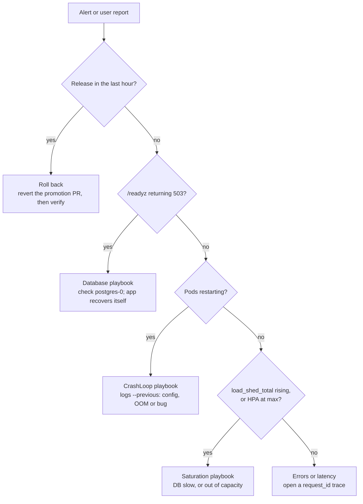

# shortly — Runbook

> Last updated 2026-10-23 for v0.7.1 / chart 0.10.0. Mirrored at
> [Claude Docs](https://claude.ai/artifact/6bjjkcg6hjcAW2HbkHnUzV). Update both in the
> same PR as the change they describe (see `CLAUDE.md`).

Operational procedures for shortly. Commands assume you are in the repo root with `kubectl` pointed at `kind-shortly`. Design rationale lives in [DESIGN.md](DESIGN.md).

## Quick reference

| Item | Value |
| --- | --- |
| Repo | [github.com/statsguy/shortly](https://github.com/statsguy/shortly) |
| Image | `ghcr.io/statsguy/shortly` — deploy by digest, never by tag |
| Current release | v0.7.1, `sha256:f8e4982b3a4197e0d68b83ef7bd06f0213bd54afffd65f4a088c21fd0852e046` (previous: v0.7.0, `sha256:9df4c29bd25d9f69b0ce2f7776a0affeab4d2bca18c859668927e398f4a21670`) |
| Environments | kind cluster `shortly`; namespaces `staging` (Deployment, 1 replica), `prod` (Argo Rollout, canary releases, HPA 2–4 replicas) |
| Capacity | about 250 req/s per pod within SLO; HPA targets about 170 (70% of a 500m CPU request) |
| Helm release | `shortly` in each namespace; chart `deploy/helm/shortly` |
| Database | `postgres` StatefulSet per namespace; URL in Secret `shortly-db` key `url` |
| Canary (prod) | New versions get 10%, then 50% of the Gateway's traffic, each step judged by Prometheus (traffic, 5xx ≤ 1%, redirect p99 ≤ 250 ms), then 100%: about 7 min. A failed step aborts and `deploy.sh` rolls back. Rollbacks to the last 3 revisions are immediate. See Deploy |
| Deploys | GitOps: Argo CD (namespace `argocd`) syncs each environment from `deploy/envs/<env>.yaml` on `main` within 60 s. Promote with `scripts/promote.sh`; roll back by reverting the promotion PR. UI: http://argocd.localhost:8090 (front door) |
| Front door | Gateway `gateway/shortly` (Envoy Gateway); prod = `sho.rt.localhost`, staging = `staging.sho.rt.localhost`. Locally, always on: `http://sho.rt.localhost:8080/<code>`; the dev tools at `http://{argocd,grafana,prometheus,alertmanager}.localhost:8090` (the front door, Local cluster operations) |
| Endpoints | `/healthz` liveness · `/readyz` readiness on port 8000 · `/metrics` on port **9100** (Prometheus only, by NetworkPolicy) |
| Backups | CronJob `postgres-backup` per namespace, hourly at :41 UTC → S3 bucket `shortly-backups/<ns>/` (SeaweedFS, namespace `backups`), 7 days. RPO up to 1 h; restore: `scripts/restore-drill.sh` and "Restore Postgres from a backup" |
| Cleanup | CronJob `shortly-cleanup`, hourly at :17 UTC: deletes links expired more than 7 days ago (`cleanup:` in the chart values) |
| Network | Default-deny ingress per namespace; Postgres accepts shortly only; the app may reach DNS and Postgres only (`networkPolicy` values, `deploy/kind/network-policies.yaml`) |
| Logs | JSON on stdout; `request_id` and `trace_id` on every line |
| SLOs | redirects 99.9% available and 99% < 50 ms; creates 99.5% and 99% < 100 ms; 30-day window (`deploy/prometheus/slos.yaml`) |
| Alerts | Rules in `deploy/helm/shortly/rules/` (shipped by the prod release). kind: Prometheus, Alertmanager and Grafana in namespace `monitoring` (see Local cluster operations). Compose: `http://localhost:9090/alerts` |
| Admission | Kyverno (namespace `kyverno`) refuses shortly images without release provenance in `staging` and `prod`, and reports images outside the allowlist (`deploy/policies/`) |
| Rate limit | `POST /links`: per client IP (IPv6 /64), burst 20 then 60 per minute → 429 + `Retry-After`; state in Postgres, shared by all pods (`config.rateLimit`) |
| Alert routing | anything in `staging` → `staging`; `severity=page` → `pager`; `severity=ticket` → `tickets` (`deploy/kind/monitoring-values.yaml`) |

```bash
# Most-used commands
D=sha256:f8e4982b3a4197e0d68b83ef7bd06f0213bd54afffd65f4a088c21fd0852e046
scripts/promote.sh staging $D --pr                         # deploy = merge this PR (Argo CD syncs)
scripts/promote.sh prod $D --pr                            # after staging ran it
kubectl -n argocd get applications                         # SYNC STATUS / HEALTH per environment
git log --oneline -5 -- deploy/envs/prod.yaml              # what prod ran; roll back = revert one
kubectl -n prod get pods -l app.kubernetes.io/name=shortly # pod status
kubectl -n prod logs -l app.kubernetes.io/name=shortly --tail=100
kubectl -n prod get rollout shortly                        # prod: PHASE Healthy, or the canary's step
kubectl -n staging rollout status deploy/shortly
kubectl -n prod get events --sort-by=.lastTimestamp | tail -20
kubectl -n prod get hpa shortly                            # current CPU % vs target, replicas
curl -s http://sho.rt.localhost:8080/readyz              # the user path; staging: staging.sho.rt.localhost
```

## Health checks and key queries

shortly is healthy when every desired pod is Ready, `/readyz` returns 200 through the Service, and the 5xx rate is near zero.

```bash
NS=prod
kubectl -n $NS get rollout,deploy shortly 2>/dev/null     # READY must equal desired (prod: a Rollout, Healthy)
kubectl -n $NS get hpa shortly                             # TARGETS like "12%/70%", never "<unknown>"
kubectl -n $NS get pods -l app.kubernetes.io/name=shortly -o wide   # restarts, node placement
kubectl -n $NS exec postgres-0 -- wget -q -O- http://shortly/readyz # through the Service, in-cluster
helm -n $NS status shortly                                # STATUS: deployed
```

Do not judge health through `kubectl port-forward svc/...`: it attaches to one pod and stops working when that pod is replaced.

**PromQL** (Prometheus at `http://localhost:9090` with the `obs` compose profile, or your cluster's Prometheus):

| Question | Query |
| --- | --- |
| Traffic and errors by route | `sum by (route, status) (rate(http_requests_total[5m]))` |
| 5xx ratio | `sum(rate(http_requests_total{status=~"5.."}[5m])) / sum(rate(http_requests_total[5m]))` |
| p99 latency by route | `histogram_quantile(0.99, sum by (le, route) (rate(http_request_duration_seconds_bucket[5m])))` |
| Redirect outcomes | `sum by (outcome) (rate(link_resolutions_total[5m]))` |
| Code space filling up | `rate(code_collisions_total[1h])` |
| Readiness failing | `rate(http_requests_total{route="/readyz",status="503"}[5m])` |
| Load being shed, and why | `sum by (reason) (rate(load_shed_total[5m]))` (concurrency, pool, db_timeout) |
| Pool saturation per pod | `db_pool_in_use / db_pool_size` |
| Error budget left, per SLO (1 = untouched, below 0 = overspent) | `slo:error_budget_remaining:ratio` |
| Current burn rate (1 = on pace to spend exactly the 30-day budget) | `slo:sli_error:ratio_rate1h / on(slo) group_left () (1 - slo:objective:ratio)` |

**Logs.** Filter structured fields with `jq`:

```bash
kubectl -n prod logs -l app.kubernetes.io/name=shortly --tail=500 \
  | jq -c 'select(.level=="error" or .level=="warning")'
kubectl -n prod logs -l app.kubernetes.io/name=shortly --tail=2000 \
  | jq -c 'select(.request_id=="<id from the x-request-id response header>")'
```

A `trace_id` in a log line opens the full trace in Jaeger (`http://localhost:16686`, search by trace ID) when tracing is enabled.

## Cut a release

A release is a pushed `vX.Y.Z` tag on a `main` commit whose `pyproject.toml` version matches; the workflow does the rest.

1. Open a PR that bumps `version` in `pyproject.toml` (semver: patch for fixes, minor for features, major for breaking API changes). Merge it once CI is green.
2. Tag the merge commit and push the tag:

   ```bash
   git switch main && git pull
   git tag v0.3.0 && git push origin v0.3.0
   ```
3. Watch **Actions → Release**. It fails before publishing if the tag and version differ or the image scan finds a fixable HIGH/CRITICAL vulnerability.
4. Copy the digest from the GitHub Release notes. Every deploy uses this digest.
5. Check the provenance. `promote.sh` and CI do this themselves for every promotion, but you can run the same check by hand:

   ```bash
   D=sha256:<digest from the release notes>
   scripts/verify-image.sh ghcr.io/statsguy/shortly@$D
   # verified: built by …/release.yml@refs/tags/v0.3.0, from … refs/tags/v0.3.0 @ <commit>
   ```

   It must exit 0. Then record the digest in the Quick reference above (`tests/test_deploy_gate.py` verifies the digest documented there), and promote it: Deploy, below.

**If the release workflow fails**

| Failing step | Cause | Fix |
| --- | --- | --- |
| Tag must match pyproject version | Tagged the wrong commit, or forgot the bump | `git push --delete origin vX.Y.Z && git tag -d vX.Y.Z`; fix; re-tag |
| Scan image | New fixable CVE in a dependency or base image | Bump it (`uv lock --upgrade-package <pkg>` or merge the Dependabot PR), merge, re-tag |
| Build and push | Registry or network error | Re-run the job; nothing was published |
| Attest / Create release | Permissions or API error | Re-run the job; the image is already pushed, so the digest is unchanged |

Never move or re-use a published tag; cut a new patch version instead.

## Deploy

Staging and prod are deployed by **Argo CD from git** (docs/DESIGN.md, GitOps with Argo CD). What runs in an environment is the `image.digest` in `deploy/envs/<env>.yaml` on `main`; a merged PR that changes it is the deploy, and Argo CD applies it within a minute. Promote the verified digest to staging, check it, then promote the identical digest to prod. Never rebuild for prod.

1. Promote to staging. `promote.sh` verifies the digest's provenance, writes it into the env file with its version, and with `--pr` opens the PR:

   ```bash
   git switch main && git pull
   scripts/promote.sh staging sha256:<digest from the release notes> --pr
   ```

   CI verifies the provenance again. **Merge the PR: that is the deploy.**
2. Watch Argo CD sync it (the migration Job runs first, as a PreSync hook):

   ```bash
   kubectl -n argocd get application shortly-staging -w      # SYNC STATUS Synced, HEALTH Healthy
   kubectl -n staging get deploy shortly -o jsonpath='{.spec.template.spec.containers[0].image}{"\n"}'
   ```
3. Check staging (see Health checks):

   ```bash
   kubectl -n staging exec postgres-0 -- wget -q -O- http://shortly/readyz
   # through the Gateway, as users (the front door)
   curl -s -X POST http://staging.sho.rt.localhost:8080/links -H 'content-type: application/json' -d '{"url":"https://example.com"}'
   curl -si http://staging.sho.rt.localhost:8080/<code from the response> | head -3   # expect 307 + Location
   ```
4. Promote the same digest to prod. `promote.sh` (and CI) refuse a digest that staging hasn't run on `main`:

   ```bash
   git switch main && git pull
   scripts/promote.sh prod sha256:<same digest> --pr
   ```

   If it says `REFUSED: staging has not run …` but `grep digest deploy/envs/staging.yaml` on an up-to-date main shows that digest, the guard itself is wrong (as in PR #55): don't hand-edit around it; fix the script. CI runs the same check in `tests/test_gitops.py`.

   Merge it. Prod is a **canary**: the Rollout gives the new version 10%, then 50% of the traffic, judging each step (about 7 minutes; "Canary releases" below):

   ```bash
   kubectl -n prod get rollout shortly -w                     # step, weights, PHASE Healthy at the end
   kubectl -n argocd get application shortly-prod             # Synced; Healthy once the canary is done
   ```
5. Watch for 15 minutes: 5xx ratio, p99 latency, restarts. The canary checks the first few minutes on a share of traffic; it doesn't replace this. If anything regresses, roll back (next section).

The Argo CD UI shows the same, with diffs and history: http://argocd.localhost:8090, user `admin`, password from `kubectl -n argocd get secret argocd-initial-admin-secret -o jsonpath='{.data.password}' | base64 -d`.

### Canary releases

What happens in prod after a new version is synced (docs/DESIGN.md, Canary releases):

| Step | Traffic on the new version | Judged by |
| --- | --- | --- |
| 1–2 | 10% (1 pod) | analysis: 60 s delay, then 4 checks 30 s apart |
| 3–4 | 50% | the same |
| done | 100%; old pods removed 30 s later | — |

Each check, on the new version's pods only: at least 0.5 req/s of traffic, a 5xx ratio of at most 1%, and a redirect p99 of at most 250 ms. While each analysis runs, its `synthetic-traffic` Job sends 20 req/s through the Gateway (links to `example.com`); with real users, set `canary.analysis.syntheticTraffic.enabled: false` in `deploy/envs/prod.yaml`.

```bash
kubectl -n prod get rollout shortly -w                                   # PHASE, step, weights
kubectl -n prod get httproute shortly -o jsonpath='{range .spec.rules[0].backendRefs[*]}{.name}={.weight}{" "}{end}{"\n"}'
kubectl -n prod get analysisrun                                          # one per analysis step
kubectl -n prod get analysisrun <name> -o jsonpath='{range .status.metricResults[*]}{.name}: {.phase} {.measurements[-1:].value}{"\n"}{end}'
```

Stop a canary by hand (traffic goes back to stable at once), then revert the promotion PR so git says what should run:

```bash
kubectl -n prod patch rollout shortly --subresource=status --type=merge -p '{"status":{"abort":true}}'
gh pr list --state merged --search "deploy: in:title" --limit 3       # find the promotion PR
git revert <its merge commit> && git push   # via a PR, as for any change to main
```

Steps and thresholds are chart values (`canary:` in `values.yaml`). An aborted canary leaves the Application **Degraded** until the revert is merged; that's expected (Argo CD and git agree, the Rollout refused the version).

**First upgrade onto chart 0.10.0** (Argo CD takes over): `scripts/cluster.sh up` installs Argo CD and applies `deploy/argocd/`. Each Application adopts the resources `deploy.sh` created (same names) and syncs `main`; nothing restarts unless `main` differs from what runs. Then delete Helm's release records, so that a stray `helm` command can't act on resources Argo CD owns: `kubectl -n staging delete secret -l owner=helm,name=shortly` and the same for `prod`. From then on, `deploy.sh` refuses both environments.

**First upgrade onto chart 0.9.0** (prod becomes a Rollout): `deploy.sh` keeps the old Deployment serving (it annotates it `helm.sh/resource-policy: keep`), waits for the Rollout to be Healthy, then deletes the Deployment, and prints `migrated`. Meanwhile it shows `first version, no canary`: the first Rollout version starts at 100% (there is no stable version yet), so this one deploy has no canary. If it fails, the rollback brings the Deployment back under Helm; check `kubectl -n prod get deploy,rollout`.

**First upgrade onto chart 0.2.0** (the HPA arrives): the chart stops setting `replicas`, so Kubernetes may briefly set an existing prod Deployment to 1 replica until the HPA restores its minimum of 2, typically within 15 s. Do this upgrade at a quiet time, then check `kubectl -n prod get hpa,deploy shortly`. Fresh installs are not affected.

**`deploy.sh` (CI's e2e and break glass only).** It refuses an environment that Argo CD manages (`REFUSED: … deployed by Argo CD from git`). For a digest, it first verifies the image's provenance (`scripts/verify-image.sh`) and stops if that fails; a tag is accepted only on a `kind-*` context. Then it runs `helm upgrade --install --rollback-on-failure --wait --timeout 3m` with the environment's values file (prod: `--wait=legacy`, then it follows the canary). Override the timeout with `DEPLOY_TIMEOUT=5m`. Extra arguments go to Helm, for example `--set config.logLevel=DEBUG`.

**If `deploy.sh` says REFUSED**, nothing was deployed:

| Message | Cause | Fix |
| --- | --- | --- |
| `no valid provenance from …release.yml` | Wrong or mistyped digest, an image from somewhere else, or the registry or Sigstore unreachable | Copy the digest from the GitHub Release notes again; check network access to `ghcr.io` and `tuf-repo-cdn.sigstore.dev` |
| `not from a release tag` | The image was built by `release.yml` but from a branch | Deploy a tagged release |
| `is a tag; outside kind, deploy a released digest` | A tag was passed against a non-kind cluster | Use the digest from the release notes |
| `gh (GitHub CLI) is required` | `gh` isn't installed | `brew install gh` |

**Deploy by hand while Argo CD manages the environment** (break glass: git or GitHub is unreachable mid-incident, or the cluster must run something git doesn't say yet). Turn auto-sync off first, or Argo CD reverts you within seconds; turn it back on, from git, as soon as you can:

```bash
kubectl -n argocd patch application shortly-prod --type merge -p '{"spec":{"syncPolicy":{"automated":null}}}'
ARGOCD_OVERRIDE=1 scripts/deploy.sh prod ghcr.io/statsguy/shortly@$D
# afterwards: put the same digest in deploy/envs/prod.yaml via a PR, merge, then restore auto-sync:
kubectl apply -f deploy/argocd/applications.yaml
```

Say so in the incident channel. If verification itself is broken (Sigstore down), add `INSECURE_SKIP_VERIFY=1` too; it prints a warning, and the cluster's admission policy still applies (see "Admission policy refuses pods").

**If a deploy fails**, the old version keeps serving: a staging rollout that never gets ready stalls with the old pods up, and a failed prod canary is aborted, so users only saw it on its share of traffic. The Application shows Degraded (or the sync failed). Find out why, then revert the promotion PR (prod canary: see [Canary aborted](#canary-aborted)):

```bash
kubectl -n argocd get application shortly-prod -o jsonpath='{.status.operationState.message}{"\n"}'
kubectl -n prod get events --sort-by=.lastTimestamp | tail -30
kubectl -n prod get jobs                                      # a failed migrate Job is kept
kubectl -n prod logs job/shortly-migrate-1
kubectl -n prod logs -l app.kubernetes.io/name=shortly --previous --tail=50
```

## Roll back

Roll back first, investigate second: when a release is bad, restore the last good revision, then debug from logs and the failed revision.

**Automatic.** A staging release whose pods never become ready stalls with the old pods serving. In prod, a canary that fails analysis or isn't ready within 180 s is aborted: all traffic stays on the old version. Either way the environment keeps working; git still names the bad digest, so finish with a manual rollback (the revert below) to make git true again.

**Manual: revert the promotion** (the release deployed fine but misbehaves, or a canary was aborted):

1. Find the promotion PR and revert it:

   ```bash
   git log --oneline -5 -- deploy/envs/prod.yaml        # "deploy: vX.Y.Z to prod"
   git switch -c revert-prod main && git revert <commit> && git push -u origin revert-prod
   gh pr create --fill                                  # CI checks the old digest's provenance again
   ```

   Merge it. Argo CD syncs within a minute. In prod, going back to one of the last 3 versions skips the canary steps (`rollbackWindow`): Healthy within seconds.
2. Verify:

   ```bash
   kubectl -n argocd get application shortly-prod     # Synced, Healthy
   kubectl -n prod get rollout shortly -o jsonpath='{.spec.template.spec.containers[0].image}{"\n"}'
   kubectl -n prod exec postgres-0 -- wget -q -O- http://shortly/readyz
   ```

   The image must be the previous digest.
3. Roll back staging the same way if the bad release is there, so the environments don't diverge.
4. Open an incident note (see Incident process) with the bad digest and the revert PR.

**Faster than a PR**, when every minute counts: Argo CD can sync the Application to the previous git revision (UI: History and rollback; it turns auto-sync off while you're there). Merge the revert anyway, then turn auto-sync back on (`kubectl apply -f deploy/argocd/applications.yaml`): until then, git and the cluster disagree.

**Schema is not rolled back.** A rollback runs the migration Job too (Argo CD runs it on every sync), but with the older image it finds the database at a revision it doesn't know and leaves the schema as it is (`migrate: the database is at a newer revision than this release (a rollback)` in its log). It never downgrades. That is safe because every migration must be backward compatible with the previous version (expand/contract).

If a migration itself broke something and the old code cannot run on the new schema, downgrade **before** rolling back. Only the new image contains the new revision, so the old one cannot undo it:

1. Back up the database (`kubectl -n prod exec postgres-0 -- pg_dump -U shortly shortly > backup.sql`).
2. Downgrade one revision from a pod still running the new image:

   ```bash
   POD=$(kubectl -n prod get pods -l app.kubernetes.io/name=shortly,rollouts-pod-template-hash=$(kubectl -n prod get rollout shortly -o jsonpath='{.status.currentPodHash}') -o name | head -1)
   kubectl -n prod exec $POD -- alembic downgrade -1
   kubectl -n prod exec $POD -- alembic current
   ```
3. Then revert the promotion as above.

**Rehearsal.** `scripts/k8s-e2e.sh` performs both an automatic and a manual rollback on every PR, plus a healthy and a faulty canary. If those steps start failing in CI, treat it as a broken rollback path, not a flaky test.

## Restore Postgres from a backup

Each environment's Postgres is dumped hourly (CronJob `postgres-backup`, :41 UTC) to the bucket `shortly-backups/<namespace>/` in namespace `backups`, and kept 7 days. **Up to 1 hour of writes is lost on restore** (the recovery point): links created after the dump you restore are gone, so say so in the incident.

**1. Choose the dump, and prove it restores.** Restore drills never touch the source:

```bash
LIST=1 SOURCE=prod scripts/restore-drill.sh            # the backups: size, time
KEEP=1 SOURCE=prod scripts/restore-drill.sh            # newest, into a scratch DB in namespace restore-drill
KEEP=1 SOURCE=prod DUMP=shortly-20261022T204100Z.dump scripts/restore-drill.sh   # a specific one
kubectl -n restore-drill exec -it restore -c postgres -- psql -U shortly shortly   # look before you trust it
```

Take the newest dump from **before** the problem. After a bad migration or a mass delete, that is not the newest one.

**2. Restore into the environment.** Stop everything that writes, restore, then let traffic back:

```bash
NS=prod
kubectl -n $NS scale rollout/shortly --replicas=0         # staging: deploy/shortly; the HPA leaves 0 alone
kubectl -n $NS patch cronjob shortly-cleanup -p '{"spec":{"suspend":true}}'
kubectl -n $NS patch cronjob postgres-backup -p '{"spec":{"suspend":true}}'   # keep the good dumps
kubectl -n restore-drill cp -c postgres restore:/work/shortly.dump ./shortly.dump
kubectl -n $NS cp ./shortly.dump postgres-0:/tmp/shortly.dump
kubectl -n $NS exec postgres-0 -- pg_restore -U shortly -d shortly --clean --if-exists \
  --no-owner --no-privileges --exit-on-error /tmp/shortly.dump
kubectl -n $NS exec postgres-0 -- psql -U shortly shortly -c "select count(*) from links" -c "select * from alembic_version"
kubectl -n $NS scale rollout/shortly --replicas=2         # staging: deploy/shortly
kubectl -n $NS patch cronjob shortly-cleanup -p '{"spec":{"suspend":false}}'
kubectl -n $NS patch cronjob postgres-backup -p '{"spec":{"suspend":false}}'
kubectl delete namespace restore-drill
```

If the Postgres volume itself is gone, recreate the database first: `scripts/cluster.sh up` brings back an empty `postgres` StatefulSet with the existing Secrets. Then restore as above. The dump creates the tables, so skip the migration until after the restore.

**3. Check, then record.** The revision in `alembic_version` must match the release that's deployed; if the dump is older than the last migration, deploy runs the migration on the next `deploy.sh`. Note the dump's time and the gap to the incident in the postmortem: that gap is the data lost.

## Ship a schema change safely

Every migration must work with both the new code and the code it replaces, because old pods serve during a rollout and a rollback runs old code on the new schema. Destructive changes therefore take three releases.

1. **Expand** (release N): add the new shape without removing the old. New columns are nullable or have a default; new tables are unused so far.

   ```bash
   # edit src/shortly/db.py, then
   uv run alembic revision --autogenerate -m "add clicks column"
   uv run alembic upgrade head --sql      # read the SQL before committing
   uv run pytest                          # alembic check + downgrade/upgrade round trip run here
   ```
2. **Migrate code** (release N or N+1): the app writes both shapes and reads the new one. Backfill existing rows in a separate, batched job if needed, never inside the migration.
3. **Contract** (release N+2): once no running version reads the old shape (check `helm -n prod history` for what can still be rolled back to), drop it.

**Rules for the migration itself**

- Locks: in Postgres, adding a nullable column is quick; adding a `NOT NULL` column with a volatile default, changing a column type, or creating an index without `CONCURRENTLY` can lock the table. Use `op.create_index(..., postgresql_concurrently=True)` inside an `autocommit_block()`.
- Keep the hook within budget: the migration Job has `activeDeadlineSeconds: 300`. Longer work goes in a backfill job.
- Renames are a drop plus an add. Do them with expand/contract, never in one step.
- Every revision needs a working `downgrade()`; CI runs it.

## Incident playbooks

Start every incident with the same two questions: did something just change (`helm -n prod history shortly`), and is the database reachable? Most incidents are a recent release or the DB.



Ask the questions in order; the first yes picks the playbook below.

### SLO burn-rate alerts

`<Slo>BudgetBurn` (for example `RedirectAvailabilityBudgetBurn`) means users are hurting faster than the SLO allows. The `slo` label says which promise is at risk; `severity` says how fast.

| Severity | Meaning | Response |
| --- | --- | --- |
| `page` | 2% of the 30-day budget gone in an hour, or 5% in six hours; still happening | Now. Mitigate first, investigate after |
| `ticket` | 10% gone in a day or three days; a slow leak | Working hours. Find the cause before the budget runs out |

1. Find the scale and the shape:

   ```promql
   slo:sli_error:ratio_rate5m                          # error ratio now, per SLO and namespace
   slo:error_budget_remaining:ratio                    # how much of the month is left
   sum by (status) (rate(http_requests_total{route="/{code}"}[5m]))   # which status codes
   ```
2. Pick the playbook with the triage questions above. An availability SLO burning usually means 5xx: see 5xx rate rising, or Saturation if `load_shed_total` is rising. A latency SLO burning means Latency up.
3. After mitigation, watch `slo:sli_error:ratio_rate5m` drop to 0: that is your confirmation. The page itself keeps firing for up to about 30 minutes (the short window of its 6x pair), and the ticket for up to 6 hours. That is expected, so don't take it as a sign the fix failed. Silence the alert with a note instead of changing the rule.
4. If the budget is spent (`slo:error_budget_remaining:ratio` below 0), the usual policy is to freeze feature releases and spend the time on reliability until it recovers.

### ShortlyDown

No shortly target is being scraped, so every SLO alert is blind. Assume a full outage until you prove otherwise.

```bash
kubectl -n prod get pods -l app.kubernetes.io/name=shortly     # are there pods at all?
kubectl -n prod exec postgres-0 -- wget -q -O- http://shortly/readyz   # does the Service answer?
```

- Pods are missing or crash-looping: see CrashLoopBackOff, or Deploy stuck or failed.
- Pods are fine and the Service answers: the problem is the scrape, not the app. Check the target in Prometheus (Status → Targets, `serviceMonitor/prod/shortly`), the ServiceMonitor (`kubectl -n prod get servicemonitor shortly`), and any NetworkPolicy. Fix it anyway: until scraping works, nothing else can page.

### ShortlyNoAvailablePods

One environment's Deployment (staging) or Rollout (prod) has zero ready pods, so every request to it fails. The alert carries the `namespace`; the burn-rate and readiness alerts for that namespace are inhibited, because they are symptoms of the same thing.

```bash
NS=prod
kubectl -n $NS get deploy,rollout,rs,pods -l app.kubernetes.io/name=shortly
kubectl -n $NS get events --sort-by=.lastTimestamp | tail -20
helm -n $NS history shortly
```

| You see | Cause | Fix |
| --- | --- | --- |
| `READY 0/0`, desired 0 | Someone (or something) scaled it to zero | `helm -n $NS rollback shortly <last good rev>`, or `kubectl -n $NS scale deploy/shortly --replicas=2` (prod: `rollout/shortly`) |
| Pods crash-looping | Bad release or config | CrashLoopBackOff playbook; roll back |
| Pods Pending | No room on the nodes | Deploy stuck or failed playbook (`Insufficient cpu/memory`) |
| Pods Running but not Ready | Database unreachable | Pods not Ready playbook |

### Users can't reach the app, but pods are Ready

The Gateway is the user path; probes and Prometheus go around it. So a broken front door looks like **traffic dropping**, not errors: no alert fires on the pods.

```bash
kubectl -n gateway get gateway shortly                         # PROGRAMMED must be True
kubectl -n prod get httproute shortly -o jsonpath='{.status.parents[0].conditions}'   # Accepted, ResolvedRefs
kubectl -n envoy-gateway-system get pods                       # envoy-gateway (controller) and the proxy
kubectl -n envoy-gateway-system logs deploy/envoy-gateway --tail=50
kubectl -n prod exec postgres-0 -- wget -q -O- --header 'Host: sho.rt.localhost' http://shortly-gateway.envoy-gateway-system.svc/readyz
```

| What you see | Cause | Fix |
| --- | --- | --- |
| Gateway not `Programmed` | The controller is down, or the EnvoyProxy/GatewayClass is invalid | Controller logs; `kubectl get gatewayclass envoy -o yaml` |
| Route not `Accepted` | Its namespace isn't allowed on the listener, or `hostnames` conflict with another route | Compare with `allowedRoutes` in `deploy/kind/gateway.yaml`; one hostname per environment |
| `ResolvedRefs: False` | The route points at a Service or port that doesn't exist (a renamed release) | `kubectl -n prod get svc`; the route's `backendRefs` |
| Direct `wget http://shortly/readyz` works, through the Gateway it doesn't | The proxy can't reach the pods: a NetworkPolicy change narrowed `httpFrom` | Allow the proxy's namespace (`envoy-gateway-system`) on port 8000 |

### Pods not Ready, `/readyz` returns 503

**Likely cause:** the database is unreachable. `/healthz` stays 200, so pods are not restarted; they are only removed from the Service.

```bash
kubectl -n prod logs -l app.kubernetes.io/name=shortly --tail=200 | jq -c 'select(.msg=="database ping failed")' | tail -3
kubectl -n prod get pods -l app=postgres
kubectl -n prod logs postgres-0 --tail=50
kubectl -n prod exec postgres-0 -- pg_isready -U shortly -d shortly
```

**Fix:** restore Postgres (restart `kubectl -n prod delete pod postgres-0`, check its PVC, free disk). The app recovers by itself once the DB answers; do not restart app pods. If credentials changed, check that Secret `shortly-db` matches `postgres-auth`.

### CrashLoopBackOff

```bash
kubectl -n prod describe pod <pod> | sed -n '/Last State/,/Exit Code/p'
kubectl -n prod logs <pod> --previous --tail=30
```

| What the log or state shows | Cause | Fix |
| --- | --- | --- |
| `ValidationError for Settings` naming a field | Bad or missing config | Fix the value in `deploy/envs/<env>.yaml` or the Secret; redeploy |
| `OOMKilled` | Memory above 256Mi | Raise `resources.limits.memory`; look for a leak |
| `Liveness probe failed … context deadline exceeded` during heavy load | The process was alive but couldn't answer within 2 s: CPU starvation on the node, or a regression that put `/healthz` back in the threadpool | `kubectl top pods`/nodes; check that `healthz` is still `async def` in `api.py`; add capacity. Don't lengthen the timeout to hide it |
| Exit code 1 right after a deploy | Bad release | Roll back (Roll back section) |

### Deploy stuck or failed

The old version keeps serving (a stalled rollout, or an aborted canary). If Argo CD itself didn't apply the change, see "A merged change didn't deploy (Argo CD)" below. To see why the pods didn't come up:

```bash
kubectl -n prod get pods,jobs
kubectl -n prod get events --sort-by=.lastTimestamp | tail -30
```

| Event or state | Cause | Fix |
| --- | --- | --- |
| `ImagePullBackOff` | Wrong digest, or the GHCR package is private | Check the digest; make the package public or add `imagePullSecrets` |
| `violates PodSecurity "restricted"` | A chart change dropped a security setting | Restore the `securityContext` in the chart |
| Migrate Job `Failed` | Migration error | `kubectl -n prod logs job/shortly-migrate-<REV>`; fix the migration in a new release |
| `admission webhook … denied the request: … shortly-require-release-provenance` | The image isn't a release digest with valid provenance | See [Admission policy refuses pods](#admission-policy-refuses-pods) |
| `failed calling webhook … kyverno-svc` | Kyverno is down; no Pod can be created in `staging` or `prod` | See [Admission policy refuses pods](#admission-policy-refuses-pods) |
| `Pending`, `Insufficient cpu/memory` | Node is full (the HPA may have asked for more pods than fit) | Add nodes, or lower `autoscaling.maxReplicas`; don't lower the CPU request without re-measuring |

### Canary aborted

The prod Rollout aborted a new version (`kubectl -n argocd get application shortly-prod` shows Degraded; with `deploy.sh`, it printed `FAILED: canary aborted`). Users only saw the new version on its share of traffic, at most 50% and usually 10%, for a few minutes. Prod is serving the previous version; check that first, then find out why, then revert the promotion PR (Roll back):

```bash
kubectl -n prod get rollout shortly                     # PHASE Healthy, on the old pod hash
kubectl -n prod get analysisrun --sort-by=.metadata.creationTimestamp | tail -3
kubectl -n prod get analysisrun <newest> -o jsonpath='{range .status.metricResults[*]}{.name}: {.phase} {.message} {.measurements[-1:].value}{"\n"}{end}'
kubectl -n prod get events --sort-by=.lastTimestamp | grep -i -E 'rollout|analysis' | tail -10
```

| Failed metric or message | Meaning | Next |
| --- | --- | --- |
| `error-ratio: Failed` | The new version answered 5xx on more than 1% of its requests | Its logs: `kubectl -n prod logs -l rollouts-pod-template-hash=<hash> --tail=200` (the canary's pods are kept 30 s after the abort; staging still runs the same digest). A real bug: fix it in a new release |
| `redirect-p99: Failed` | Redirects on the new version were slower than 250 ms at p99, twice | A slow query or a CPU regression: compare with `scripts/loadtest.sh` on staging |
| `traffic: Failed` | Too little traffic to judge, not a bad release | Did the analysis's `synthetic-traffic` Job run (`kubectl -n prod get jobs`, k6 image pull, its logs)? With synthetic traffic off, real traffic was below 0.5 req/s at 10%: deploy at a busier time, or turn it on |
| metrics in `Error` | Analysis couldn't query Prometheus | `kubectl -n monitoring get pods`; the Rollout aborts after 4 errors in a row. Fix Prometheus, then deploy again |
| `ProgressDeadlineExceeded` | A canary pod wasn't ready within 180 s | Same as a crash loop or Pending pod: CrashLoopBackOff and Deploy stuck playbooks |
| `out of time` | The canary didn't finish in `CANARY_TIMEOUT` (15 min) | Was the Argo Rollouts controller running (`kubectl -n argo-rollouts get pods`)? |

Don't retry the same digest hoping for a different result: the analysis is deterministic enough that a second run will fail the same way, at the same cost.

### A merged change didn't deploy (Argo CD)

The promotion PR is merged, but the environment still runs the old version, or `kubectl -n argocd get applications` shows something other than Synced and Healthy.

```bash
kubectl -n argocd get applications
kubectl -n argocd get application shortly-prod -o jsonpath='{.status.sync.revision}{"\n"}{range .status.conditions[*]}{.type}: {.message}{"\n"}{end}{.status.operationState.phase}: {.status.operationState.message}{"\n"}'
git rev-parse origin/main                                    # what it should have synced
kubectl -n argocd get pods
kubectl -n argocd logs deploy/argocd-repo-server --tail=50
```

| What you see | Cause | Fix |
| --- | --- | --- |
| Synced, but to an older revision | Not polled yet (every 60 s), or the repo server can't reach GitHub | Wait a minute; `kubectl -n argocd annotate application shortly-prod argocd.argoproj.io/refresh=normal --overwrite` forces a check; then repo-server logs |
| `ComparisonError` | The chart doesn't render with that env file (a typo, a bad value) | The message names the template; fix it in a PR. Nothing changed in the cluster |
| OutOfSync, sync failed, `PreSync` hook failed | The migration Job failed | `kubectl -n prod logs job/shortly-migrate-1`; fix in a new release or revert. The old version keeps serving |
| Synced, Degraded, Rollout aborted | The canary was refused | "Canary aborted" above, then revert the promotion |
| Synced, Progressing for minutes | A canary in progress (about 7 minutes), or pods not becoming ready | `kubectl -n prod get rollout shortly`; "Deploy stuck or failed" |
| OutOfSync, auto-sync not running | Someone turned auto-sync off (break glass) and didn't turn it back on | `kubectl apply -f deploy/argocd/applications.yaml` after checking git says what should run |
| OutOfSync on the HTTPRoute or the `shortly-stable`/`shortly-canary` Services only | The Application lost its `ignoreDifferences` for what Argo Rollouts owns (an edited Application) | `kubectl apply -f deploy/argocd/applications.yaml` |

### Admission policy refuses pods

Kyverno checks every Pod in `staging` and `prod` before it is created (`deploy/policies/`). Pods that are already running are never touched, so a refusal blocks deploys and scale-ups, not traffic. Find which case it is:

```bash
kubectl -n prod get events --sort-by=.lastTimestamp | grep -i -E 'denied|webhook' | tail
kubectl -n kyverno get pods
kubectl get imagevalidatingpolicy,validatingpolicy     # READY must be true
```

| Message | Cause | Fix |
| --- | --- | --- |
| `shortly images must be a release digest with provenance…` | An unreleased or unattested image: a CI build, a fork, or a per-platform child digest instead of the release's index digest | Deploy the digest from the GitHub Release notes. `scripts/verify-image.sh <ref>` tells you why it fails |
| `image ghcr.io/statsguy/shortly:… does not have a digest` | A tag was used | Use `@sha256:…`; tags are never verified |
| `provenance is not from a GitHub Actions workflow build` | The attestation exists but describes a different build | Treat as suspicious: who produced this image? |
| `failed calling webhook "…kyverno…"` or `context deadline exceeded` | Kyverno is down or slow, or it can't reach `ghcr.io` / Sigstore (Rekor, TUF). The policy fails closed, so **every** new Pod in `staging` and `prod`, Postgres included, is refused | `kubectl -n kyverno logs deploy/kyverno-admission-controller --tail=50`; `kubectl -n kyverno rollout restart deploy/kyverno-admission-controller` |

**Break glass**, only when Kyverno can't be recovered and pods must start (for example a node died and prod is below its minimum). It needs cluster-admin. Say so in the incident channel first:

```bash
# 1. Remove the provenance policy (the webhook follows within seconds).
kubectl delete imagevalidatingpolicy shortly-require-release-provenance
# 2. If Kyverno itself is down, the webhook still fails closed: remove its configurations.
kubectl get validatingwebhookconfigurations,mutatingwebhookconfigurations | grep -i kyverno
kubectl delete validatingwebhookconfiguration <name>      # each kyverno one listed above
# 3. Restore as soon as possible (reinstalls Kyverno if needed and waits for the policies):
scripts/cluster.sh up
```

Afterwards, check that everything running is a release: `scripts/verify-image.sh` on each image from `kubectl -n prod get pods -o jsonpath='{..image}'`.

**Allowlist reports** (Audit in kind, so nothing is refused):

```bash
kubectl -n prod get policyreport -o wide                  # FAIL > 0: an image outside the allowlist ran
```


### A network policy blocks a connection

Symptoms: connections that time out (rather than being refused) between pods that used to talk; a new dependency that never answers; Prometheus targets `down` with `context deadline exceeded`. NetworkPolicies drop packets silently, so it looks like a slow network, not an error.

```bash
kubectl -n prod get networkpolicy                        # shortly, default-deny-ingress, postgres
kubectl -n prod describe networkpolicy shortly            # what the app may receive and send
kubectl -n prod get pods --show-labels                    # policies select by label: check them
```

| What fails | Likely cause | Fix |
| --- | --- | --- |
| The app can't reach a new service (collector, external API) | The app's egress allows DNS and Postgres only | Add a rule to `networkPolicy.extraEgress` in the env values and redeploy |
| Prometheus shows shortly targets down | Scraper pods don't match `networkPolicy.metricsFrom` (a namespace or label change) | Compare its labels with the policy; fix the values |
| A new workload in `staging` or `prod` gets no traffic | Default-deny ingress: nothing lets it in | Write a NetworkPolicy for it, as `deploy/kind/network-policies.yaml` does for Postgres |
| The app or a Job can't reach Postgres after a relabel | Postgres accepts pods labelled `app.kubernetes.io/part-of: shortly` only | Keep the label on every pod template, or change the label in both places at once: add the new one, deploy, then remove the old one (expand/contract) |

Don't delete a policy to "see if it helps" in prod. Check labels first: almost every case is a selector that no longer matches.

### 5xx rate rising

```bash
kubectl -n prod logs -l app.kubernetes.io/name=shortly --tail=1000 | jq -c 'select(.status>=500)' | tail -20
```

- 503 with `Retry-After`, and `load_shed_total` rising: the pod or the database is saturated. Its `reason` label says which. See Saturation.
- 503 on `route="/links"` only: code space exhausted (5 collisions in a row). Check `rate(code_collisions_total[1h])`; the fix is longer codes (`DEFAULT_LENGTH`) in a release.
- 500s with an `exc` field: an unhandled bug. Find the `request_id`, open its trace, roll back if it started with a release.

### Latency up

Check p99 by route, then `kubectl -n prod get hpa shortly`.

- **CPU above target and replicas rising:** the HPA is catching up with a spike. Latency should recover within about a minute.
- **Pinned at `maxReplicas`:** out of capacity; see Saturation.
- **Neither:** open a slow request's trace in Jaeger. A long `SELECT` or `INSERT` span points at the database; a gap before it points at the pool (`db_pool_in_use`).

### Saturation: load shed or HPA at max

| Signal | Cause | Fix |
| --- | --- | --- |
| `load_shed_total{reason="concurrency"}` rising; `requests_in_flight` at the limit (16); CPU high | More traffic than the pods can serve: each pod answers the excess with 503 at once instead of queueing | Normally the HPA fixes it within a minute; if HPA `REPLICAS` = max, see the next row. Raising `maxConcurrentRequests` doesn't add capacity, it only brings back the queueing |
| `load_shed_total{reason="concurrency"}` rising; CPU **low** | Requests are slow but not busy: they wait on something (the database, a lock) while holding a slot | Database first, as in the `pool` and `db_timeout` rows. If they're clean, check traces for the slow span |
| `load_shed_total{reason="db_timeout"}` rising | Queries ran past `dbStatementTimeoutMs` (2 s) or waited past `dbLockTimeoutMs` (1 s) on a lock | Postgres: `pg_stat_activity` (long-running queries, `wait_event_type = Lock`), `pg_locks`, disk and CPU. Raising the timeouts only makes requests wait longer |
| `load_shed_total{reason="pool"}` rising; `db_pool_in_use` = `db_pool_size`; CPU low | Database slow or frozen: queries hold connections | Database first (`pg_stat_activity`, locks, disk). Don't raise the pool: more connections to a struggling DB make it worse |
| HPA `REPLICAS` = max; CPU above target; p99 up; concurrency shedding | Traffic above provisioned capacity | Raise `autoscaling.maxReplicas` and keep `maxReplicas × dbPoolSize` within `maxDbConnections` and Postgres `max_connections`; add nodes if pods go Pending |
| HPA `TARGETS` shows `<unknown>` | No CPU metrics: metrics-server down, or no CPU request | `kubectl -n kube-system get deploy metrics-server`; `kubectl top pods -n prod`; `kubectl -n prod describe hpa shortly` |

```bash
kubectl -n prod describe hpa shortly | sed -n '/Conditions/,$p'    # why it did or didn't scale
kubectl top pods -n prod -l app.kubernetes.io/name=shortly
kubectl -n prod exec postgres-0 -- psql -U shortly shortly -c \
  "select state, wait_event_type, count(*) from pg_stat_activity group by 1,2"
kubectl -n prod logs -l app.kubernetes.io/name=shortly --tail=500 | jq -c 'select(.status==503) | .route' | sort | uniq -c
```

### Cleanup job not running

`ShortlyCleanupNotRunning` (ticket) means the `shortly-cleanup` CronJob hasn't succeeded for over 3 hours, or never has. Nothing user-facing breaks: expired links keep answering 410 Gone. But expired rows pile up, and the longer it stays broken, the bigger the backlog the next runs must work through (at most 100,000 rows per run).

```bash
kubectl -n prod get cronjob shortly-cleanup               # SUSPEND, LAST SCHEDULE, LAST SUCCESSFUL
kubectl -n prod get jobs -l app.kubernetes.io/name=shortly-cleanup
kubectl -n prod logs job/<the latest one> --tail=30        # one JSON line per run, or the error
```

| What you see | Cause | Fix |
| --- | --- | --- |
| Jobs fail with `cleanup failed` and a connection error | Postgres unreachable, or the network policy doesn't admit the Job (labels changed) | Database first (Pods not Ready playbook); else compare the pod's labels with the `postgres` NetworkPolicy |
| Jobs fail with a timeout (`DeadlineExceeded`) | A huge backlog, or a slow database: 900 s wasn't enough | Check the DB; the next runs continue where it stopped. To catch up faster, run it by hand (below) |
| No Jobs at all; `SUSPEND` is `True` | Someone suspended it | `kubectl -n prod patch cronjob shortly-cleanup -p '{"spec":{"suspend":false}}'` |
| No Jobs, not suspended | Created by Kyverno? Check events: an image without release provenance is refused | `kubectl -n prod get events --sort-by=.lastTimestamp \| grep -i cleanup`; see Admission policy refuses pods |
| Jobs succeed but the alert fires | kube-state-metrics down or not scraping | `kubectl -n monitoring get pods`; the alert can't see successes without it |

**Run it now**, for example after fixing the cause, or to work off a backlog. It's safe while a scheduled run is going: the two split the work.

```bash
kubectl -n prod create job cleanup-manual-$(date +%s) --from=cronjob/shortly-cleanup
kubectl -n prod logs -f job/cleanup-manual-<that number>   # "cleanup finished", deleted=…, complete=…
```

**How big is the backlog?**

```bash
kubectl -n prod exec postgres-0 -- psql -U shortly shortly -c \
  "select count(*) from links where expires_at < now() - interval '7 days'"
```

### Fault injection left on

`ShortlyFaultInjectionOn` (ticket) means `faults_injected_total` has been rising for 15 minutes: requests are failing **on purpose**. Fault injection is for canary drills, which last minutes, so either a drill was abandoned or `config.faultErrorRatio` leaked into a release.

```bash
kubectl -n prod get deploy,rollout -o yaml 2>/dev/null | grep -A1 SHORTLY_FAULT_ERROR_RATIO   # which release has it (prod: a canary drill that wasn't rolled back?)
kubectl -n prod logs -l app.kubernetes.io/name=shortly --tail=500 | grep 'FAULT INJECTION IS ON'
helm -n prod get values shortly | grep -i fault
```

Fix: if it is in `deploy/envs/`, revert that change (a PR); Argo CD removes it within a minute. If someone set it by hand, Argo CD's self-heal has already removed it, unless auto-sync is off: turn it back on (`kubectl apply -f deploy/argocd/applications.yaml`). Then find out how it got there: it must never be in `deploy/envs/`.

### Backup job not running

`ShortlyBackupNotRunning` (ticket) means the `postgres-backup` CronJob hasn't succeeded for over 2 hours, or never has. Nothing user-facing breaks, but every hour without a backup is an hour of links that a database loss would take with it.

```bash
kubectl -n prod get cronjob postgres-backup               # SUSPEND, LAST SCHEDULE, LAST SUCCESSFUL
kubectl -n prod get jobs -l app.kubernetes.io/name=postgres-backup
kubectl -n prod logs job/<the latest one> -c dump --tail=20      # pg_dump
kubectl -n prod logs job/<the latest one> -c upload --tail=20    # rclone
```

| What you see | Cause | Fix |
| --- | --- | --- |
| `dump` fails to connect | Postgres down, or the network policy doesn't admit the Job (`component=backup` label changed) | Database first; else compare the pod's labels with the `postgres` NetworkPolicy |
| `dump` fails in `pg_restore --list` | The archive is corrupt (disk full in the `work` volume, killed mid-write) | Re-run; if it repeats, check the volume's `sizeLimit` against the database size |
| `upload` times out or is refused | The bucket is down, or the `seaweedfs` NetworkPolicy no longer admits the Job | `kubectl -n backups get pods`; `kubectl -n backups logs statefulset/seaweedfs --tail=50` |
| `upload` gets 403 | Credentials differ between `backup-s3` (app namespace) and `seaweedfs-s3` (backups) | Delete `backup-s3` in the namespace and re-run `scripts/cluster.sh up`, which copies them again |
| No Jobs; `SUSPEND` is `True` | Suspended, perhaps by a restore that didn't finish | `kubectl -n prod patch cronjob postgres-backup -p '{"spec":{"suspend":false}}'` |

**Take one now**, after fixing the cause: `kubectl -n prod create job backup-manual-$(date +%s) --from=cronjob/postgres-backup`. Then prove it: `SOURCE=prod scripts/restore-drill.sh`.

### Rate limiting: 429 on POST /links

Each client (IP address, IPv6 by /64) may create `config.rateLimit.burst` links at once (default 20), then `createsPerMinute` per minute (default 60). Beyond that it gets **429 + `Retry-After`**. Redirects are never limited, and a 429 is a client error, so it doesn't burn the availability SLO. `ShortlyRateLimiting` (ticket) means more than 10% of creates were refused for 30 minutes. Find out who:

```bash
kubectl -n prod logs -l app.kubernetes.io/name=shortly --since=1h | grep '"rate limited"' \
  | python3 -c 'import json,sys,collections; c=collections.Counter(json.loads(l)["client"] for l in sys.stdin); print(c.most_common(10))'
```

| What you see | Cause | Fix |
| --- | --- | --- |
| One or a few clients account for almost all refusals | Abuse, or a client integration stuck in a loop | Nothing urgent: the limit is doing its job. Block it at the edge if it persists |
| Many different clients, each refused a little | The limit is too tight for real use | Raise `config.rateLimit` in the env values and redeploy |
| One client that is really many users (an office or a mobile carrier's NAT) | Shared address | Raise the limit, or exempt that range at the ingress |
| Every request seems to come from the same address (the ingress, or a node) | `config.forwardedAllowIps` doesn't include the proxy, so its address is the "client" | Set it to the ingress or load-balancer addresses (never `*` on the internet: then anyone can claim any address) |

The limiter's state is a small Postgres table, `rate_limits`, with one row per recently active client. Each create therefore makes two queries instead of one. When the database is slow or the pool is full, creates are shed with 503 like any other request (see Saturation), not refused with 429. To turn limiting off in an emergency: `scripts/deploy.sh prod <digest> --set config.rateLimit.createsPerMinute=0`.

### Code collisions rising

Not an outage: retries absorb it. Plan a release that raises `DEFAULT_LENGTH` from 7 to 8 (62× more codes). Existing codes keep working.

### A vulnerability is announced in a dependency

Check whether the running digest is affected (the SBOM is attached to the image). Bump the package (`uv lock --upgrade-package <pkg>`) or merge the Dependabot PR, cut a patch release, deploy.

## CI failures

Every CI step can be reproduced locally with the same command; reproduce before you guess.

The kind e2e runs as two jobs in parallel, `kind e2e (platform)` and `kind e2e (delivery)`; the required check `deploy to kind, rollback drill` fails if either does, so open the failing one. Platform covers steps 3b, 3c and 6–12 (rate limit, front door, HPA, monitoring, admission, network policies, cleanup, backups, GitOps); delivery covers 4, 5 and 5b (rollbacks and canaries). To rerun just one half locally: `E2E_SUITE=delivery IMAGE=shortly:e2e scripts/k8s-e2e.sh`.

A PR that changes only Markdown files (other than `docs/RUNBOOK.md`) skips the work in every CI job (`scripts/ci-scope.sh`): all four checks pass in under a minute with the notice "Docs-only change". If a PR you expected to be tested shows that notice, check its file list. A RUNBOOK change always runs everything, because the tests and the e2e read the current release digest from it.

| Job → step | Usual cause | Reproduce and fix |
| --- | --- | --- |
| test → `test_generated_slo_rules_are_current` | `slos.yaml` or the generator changed without regenerating | `uv run python scripts/gen_slo_rules.py`, commit `deploy/helm/shortly/rules/slo.yaml` |
| test → `test_every_rule_selector_matches_something_the_app_exports` | A metric, route, label or histogram bucket changed, and an alert now selects nothing | Update the rule (or `slos.yaml`) to the new name, or revert the rename |
| test → `test_promtool_unit_tests_pass` | A rule's behaviour changed, or its annotations no longer match the test | Run promtool (command in `deploy/prometheus/tests/alerts_test.yaml`); fix the rule or update the expected alert |
| test → `test_runbook_links_point_at_real_sections` | A RUNBOOK heading was renamed | Rename it back, or update `runbook_url` in the rules |
| lint → `uv sync --locked` | `pyproject.toml` changed without updating `uv.lock` | `uv lock`, commit the lockfile |
| lint → format check | Unformatted code | `uv run ruff format .` (pre-commit does this on commit) |
| lint → ruff / mypy | Lint or type error | `uv run ruff check .` / `uv run mypy src tests` |
| test → `test_toolchain.py` | Dockerfile Python and `.python-version` differ (e.g. a Dependabot base-image bump) | Move both, plus `requires-python` and ruff `target-version`, in one PR |
| test → `test_models_match_migrations` | `db.py` changed without a migration | `uv run alembic revision --autogenerate -m "…"` |
| test → coverage below 90% | New code without tests | `uv run pytest --cov-fail-under=90` with Docker running |
| test → `Docker is required` | Integration tests can't reach Docker | CI only; re-run. Locally they skip instead |
| image → Scan image | New fixable HIGH/CRITICAL CVE, often transitive | Find the package in the Trivy table; `uv lock --upgrade-package <pkg>` or bump the base digest |
| image → Smoke test | The container misbehaves | `docker build -t shortly:dev . && scripts/smoke.sh`; on failure it prints container logs |
| k8s → digest-mode render | API server rejects a manifest (e.g. an invalid label) | `helm template … --set image.digest=sha256:<64 hex> \| kubectl apply --dry-run=server -f -` against kind |
| k8s → monitoring checks | `scrapes 0 healthy prod pods` (ServiceMonitor or labels), `rule groups loaded` (PrometheusRule missing: is `monitoring.clusterWide` on for prod?), `rules not evaluating cleanly` (a PromQL error), or `a dashboard query is invalid` | `ALERT_DRILL=0 scripts/monitoring-check.sh` against kind |
| k8s → alert drill | `alert drill (scripts/alert-drill.sh)` with its output indented above it: the staging alert never reached Alertmanager, or went to the wrong receiver. It ran in the background from step 3a, so it's reported at step 7 | `scripts/alert-drill.sh` against kind; check Prometheus → Alerts, then Alertmanager → Status → Config |
| test → `test_alertmanager_config_is_valid` / `test_alerts_route_to_the_right_receiver` | The Alertmanager config in `deploy/kind/monitoring-values.yaml` is invalid, or a route changed | `amtool config routes test --config.file=… namespace=prod severity=page` (the test prints the receiver it got) |
| test → `test_every_dashboard_query_matches_something_the_app_exports` | A dashboard query selects a metric or label the app doesn't export | Fix the query in `deploy/helm/shortly/dashboards/slo.json` |
| test → `test_documented_release_verifies` | The Quick reference digest is wrong, or the registry or Sigstore is unreachable from CI | `scripts/verify-image.sh <that digest>`; fix the digest in the Quick reference, or re-run if it was a network blip |
| test → `test_provenance_verdicts_against_the_real_registry` | The documented release no longer verifies, a refused case was admitted, or the registry or Sigstore was unreachable | Run the Kyverno CLI command the test builds (`tests/test_admission_policies.py`, `_apply`); compare with `scripts/verify-image.sh` on the same digest |
| test → `test_provenance_policy_actually_checks` | A policy edit made a check pass everything (for example a regex that matches any signer) | Revert the edit; the test names the mutation that was wrongly admitted |
| test → `test_allowlist_verdicts` / `test_provenance_policy_matches_the_deploy_gate` | The allowlist or the signer rules changed | Make `deploy/policies/` and `scripts/verify-image.sh` agree again |
| test → `test_ratelimit.py` | The limiter's semantics changed (burst, sustained rate, retry time), or the in-memory and Postgres limiters disagree | `uv run pytest tests/test_ratelimit.py -v`; the contract tests run both limiters on the same fake clock |
| test → other `test_deploy_gate.py` tests | `deploy.sh` or `verify-image.sh` lost a check | Read the failing case: each one names the image that must be refused |
| k8s → Lint and schema-validate | A chart manifest or a policy in `deploy/policies/` fails its schema | Run the step's `kubeconform` command locally; the error names the field |
| k8s → backup and restore | `backup: the Job did not complete` (its logs print above: database, bucket, credentials), `a pod that isn't a backup pod reached the backup bucket` (the `seaweedfs` NetworkPolicy), `the scratch database never became ready` (the download failed: the `fetch` log prints above), `restored schema at revision …` or `restored N links, expected M` (the dump is incomplete or stale), `canary link … is not in the restored database` | `SOURCE=prod KEEP=1 scripts/restore-drill.sh` against kind; see Backup job not running |
| k8s → expired-link cleanup | `index … missing or invalid` (the concurrent index build failed: see the migrate Job's logs), `the Job did not complete` (its logs print above: DB access, provenance, Pod Security), `left …, want e2efut1,e2enew1` (the cutoff or grace period changed) | `kubectl -n staging logs job/cleanup-e2e`; `uv run pytest tests/test_cleanup.py -v` |
| k8s → gateway | `prod /readyz via sho.rt.localhost` or `staging …` (the route isn't attached or the proxy isn't ready), `create through sho.rt.localhost failed`, `a prod link resolved through staging's hostname` (two routes claim one hostname), `an unknown hostname was routed somewhere` (a route without `hostnames`) | `kubectl -n gateway get gateway shortly`; `kubectl -n prod get httproute shortly -o yaml` (status: `Accepted`, `ResolvedRefs`); `kubectl -n envoy-gateway-system logs deploy/envoy-gateway --tail=50` |
| k8s → network policies | `a non-Prometheus pod scraped prod's metrics port` or `a pod that isn't shortly reached Postgres` (a policy missing, or the CNI not enforcing NetworkPolicy), or a `control:` line (the allowed path broke: check labels and `networkPolicy` values) | `kubectl -n prod get networkpolicy`; the step's commands in `scripts/k8s-e2e.sh` |
| k8s → admission checks | `was ADMITTED, expected refused` (the policy isn't enforcing), `was refused, expected admitted` (the release no longer verifies in-cluster: often no network to Sigstore), `not by the provenance policy` (Pod Security or a manifest error), or no allowlist reports | `scripts/admission-check.sh` against kind; `kubectl -n kyverno logs deploy/kyverno-admission-controller` |
| k8s → HPA drill | `HPA has no CPU metrics` (metrics-server not ready); `load too light` (CPU never got 10% past the target: raise the drill's `RATE`); or no scale-up despite high CPU (a real HPA problem) | `IMAGE=shortly:e2e scripts/k8s-e2e.sh`, or just `scripts/hpa-drill.sh` against a running kind cluster |
| k8s → rate limit | `only N creates succeeded, the burst is 20` (limit lower than the chart says, or DB errors), `at most N allowed` or `none refused` (limit missing, or counted per pod instead of shared; the check allows for the tokens that refill while it runs), `another client was refused` (the limit isn't per client: check `forwardedAllowIps`) | `kubectl -n prod logs -l app.kubernetes.io/name=shortly \| grep 'rate limited'`; the step's `wget` command from `postgres-0` |
| k8s → drill | Deploy, promotion or rollback broke | `scripts/cluster.sh up && docker build -t shortly:e2e . && IMAGE=shortly:e2e scripts/k8s-e2e.sh`; diagnostics print on failure |

A test that fails with warnings as errors (`filterwarnings = error`) usually means a dependency deprecated something. Fix the call site; don't silence the warning globally.

## Local cluster operations

The local environments are disposable: `scripts/cluster.sh up` rebuilds them from nothing in a few minutes.

**Prerequisites:** Docker Desktop running, plus `brew install kind kubectl helm` (Helm 4 or newer).

| Task | Command |
| --- | --- |
| Create (idempotent) | `scripts/cluster.sh up` |
| Tear down everything | `scripts/cluster.sh down` |
| Reset one environment's data (then redeploy so migrations recreate the schema) | `kubectl -n staging delete statefulset postgres && kubectl -n staging delete pvc data-postgres-0 && scripts/cluster.sh up` |
| Deploy a local build (kind only; tags are refused elsewhere) | `docker build -t shortly:dev . && scripts/deploy.sh staging shortly:dev` |
| Check an image's provenance | `scripts/verify-image.sh ghcr.io/statsguy/shortly@sha256:…` |
| Run the full e2e drill | `docker build -t shortly:e2e . && IMAGE=shortly:e2e scripts/k8s-e2e.sh` (`HPA_DRILL=0` skips the autoscaling step; `E2E_SUITE=platform` or `delivery` runs one CI half) |
| Autoscaling drill only | `scripts/hpa-drill.sh` (stops once the HPA adds a ready pod; `RATE=1500 DURATION=240s FULL=1` for a longer push to the end, with k6's summary) |
| Watch autoscaling | `kubectl -n prod get hpa shortly -w` |
| Create without the monitoring stack (saves about 1 GB of RAM) | `MONITORING=0 scripts/cluster.sh up` |
| Create without Kyverno and the admission policies | `POLICIES=0 scripts/cluster.sh up` |
| Create without the backup bucket and backup CronJobs | `BACKUPS=0 scripts/cluster.sh up` |
| Create without the front door (ports 8080 and 8090 left free) | `FRONT_DOOR=0 scripts/cluster.sh up`; then port-forward by hand, e.g. `kubectl -n monitoring port-forward svc/grafana 3000:80` |
| Open the app through the Gateway | http://sho.rt.localhost:8080 (prod) or http://staging.sho.rt.localhost:8080, always on (the front door, below) |
| Front door down? (a UI or the app doesn't answer on 8080 / 8090) | `docker ps --filter name=shortly-front-door` (two, `Up`); `scripts/cluster.sh up` recreates them. A port taken by an old `kubectl port-forward` is the usual cause: it says so; stop that one |
| Is the Gateway routing? | `kubectl -n gateway get gateway shortly` (`PROGRAMMED True`); `kubectl get httproute -A` |
| Admission checks only | `scripts/admission-check.sh` (server-side dry runs; creates nothing) |
| Admission policies and their state | `kubectl get imagevalidatingpolicy,validatingpolicy`; reports: `kubectl get policyreport -A` |
| Prometheus UI (targets, rules, alerts) | http://prometheus.localhost:8090 |
| Alertmanager UI (routing, silences) | http://alertmanager.localhost:8090 |
| Grafana (dashboard "shortly / SLOs") | http://grafana.localhost:8090, user `admin` |
| Argo CD UI | http://argocd.localhost:8090, user `admin`; password: `kubectl -n argocd get secret argocd-initial-admin-secret -o jsonpath='{.data.password}' \| base64 -d` |
| Grafana password | `kubectl -n monitoring get secret grafana-admin -o jsonpath='{.data.admin-password}' \| base64 -d` |
| Back up a database now | `kubectl -n prod create job backup-manual-$(date +%s) --from=cronjob/postgres-backup` |
| List backups / prove the newest restores | `LIST=1 SOURCE=prod scripts/restore-drill.sh` / `SOURCE=prod scripts/restore-drill.sh` (`KEEP=1` keeps the scratch DB) |
| Run the expired-link cleanup now | `kubectl -n prod create job cleanup-manual-$(date +%s) --from=cronjob/shortly-cleanup` |
| Read a pod's metrics (port 9100) | `kubectl -n prod port-forward svc/shortly 9100` → http://localhost:9100/metrics |
| Monitoring checks only | `scripts/monitoring-check.sh` (includes the alert drill; `ALERT_DRILL=0` skips it) |
| Alert drill only | `scripts/alert-drill.sh` (scales staging to 0 for about 90 s, then restores it) |
| Open psql | `kubectl -n prod exec -it postgres-0 -- psql -U shortly shortly` |
| Show the generated DB URL | `kubectl -n prod get secret shortly-db -o jsonpath='{.data.url}' \| base64 -d` |
| Which image is running | `kubectl -n prod get rollout shortly -o jsonpath='{.spec.template.spec.containers[0].image}'` (staging: `deploy`) |
| Uninstall the app only | `helm -n prod uninstall shortly` (data stays in the PVC) |

`cluster.sh up` installs, side by side, Envoy Gateway (pinned by version and digest, values in `deploy/kind/envoy-gateway-values.yaml`, namespace `envoy-gateway-system` at `baseline`) with the Gateway in `deploy/kind/gateway.yaml`, Argo Rollouts (pinned by version and digest, values in `deploy/kind/argo-rollouts-values.yaml`, namespace `argo-rollouts` at `restricted`, with the Gateway API plugin pinned by checksum for the node's architecture), metrics-server (pinned, checksum-verified, `--kubelet-insecure-tls` for kind only), kube-prometheus-stack (pinned by version and digest, values in `deploy/kind/monitoring-values.yaml`, namespace `monitoring` at the `baseline` Pod Security level), and Kyverno (pinned by version and digest, values in `deploy/kind/kyverno-values.yaml`, namespace `kyverno` at `restricted`) with the policies in `deploy/policies/`, and the backup bucket (SeaweedFS S3, pinned by digest, `deploy/kind/backups.yaml`, namespace `backups` at `restricted`, with a generated S3 identity in Secret `seaweedfs-s3`). It then creates the `staging` and `prod` namespaces enforcing the restricted Pod Security Standard, generates a random password per namespace into Secrets `postgres-auth` and `shortly-db`, and applies `deploy/kind/postgres.yaml`, the network policies, and the backup CronJob (`deploy/kind/postgres-backup.yaml`, with the bucket credentials copied into Secret `backup-s3`). It never overwrites existing Secrets.

Without a cluster, the fastest full-stack check is Docker Compose: `docker compose --profile app up -d --build --wait && scripts/smoke.sh`.

## Load test and capacity check

Measure capacity before changing CPU requests, the HPA target or the pool, and after any change to the request path. The method and the current numbers are in DESIGN.md, Capacity.

1. Start the stack with the image under test, and write down the baseline you're comparing against:

   ```bash
   docker build -t shortly:dev .
   SHORTLY_IMAGE=shortly:dev docker compose --profile app up -d --no-build --wait
   ```
2. Run the step test. The app is pinned to `APP_CPUS` (default 1) so the result means "per core":

   ```bash
   scripts/loadtest.sh                                  # steps 100 … 1200 req/s, 30 s each
   RATES="200 250 300 350" DURATION=30s scripts/loadtest.sh
   SHORTLY_DB_POOL_SIZE=2 SHORTLY_IMAGE=shortly:dev docker compose --profile app up -d --no-build --wait  # vary the pool
   ```

   Each step prints achieved rate, **goodput** (successful requests/s), p50/p95/p99 of all redirects, `ok-p99` (successful redirects only), errors, cores used and CPU ms per request, and appends to `loadtest/results/<timestamp>-cpus<N>.csv` (git-ignored).
3. Read the result. **Capacity is the highest step that PASSes**. Past it, the pod sheds: errors are fast 503s, goodput levels off and `ok-p99` should stay near 100 ms. A FAIL with 0% errors and climbing p99 means queueing, so the concurrency limit is off or too high. Errors other than 503 are a bug, so investigate before trusting the numbers. To compare limits: `SHORTLY_MAX_CONCURRENT_REQUESTS=32 docker compose --profile app up -d --wait` (`0` turns the limit off).
4. Compare A/B on the same machine in the same session, and run each side twice: the noise between runs is about ±15%.
5. If capacity per pod changed, set `resources.requests.cpu` to the cores used at the new passing rate and keep the HPA target at about 70%. Then update DESIGN.md, Capacity, and the Quick reference above in the same PR.
6. Prove that autoscaling still works in-cluster: `scripts/hpa-drill.sh`.

Don't run load tests against prod. The drill runs against the kind `prod` namespace only because it is disposable.

## Change an SLO or an alert

1. SLOs: edit `deploy/prometheus/slos.yaml`, then run `uv run python scripts/gen_slo_rules.py`. Never edit `deploy/helm/shortly/rules/slo.yaml` by hand. Cause-based alerts: edit `deploy/helm/shortly/rules/shortly.yaml`. Both ship with the chart, so a rule change is deployed like code: staging is not affected, and prod picks it up on its next release.
2. Add or update a promtool test in `deploy/prometheus/tests/alerts_test.yaml`. It needs one case where the alert fires and one where it must stay quiet.
3. Give every alert a `runbook_url` pointing at a section of this runbook. Write the section first.
4. Run `uv run pytest tests/test_alert_rules.py`; it needs Docker for the promtool step.
5. Check it live: in kind, merge it (Argo CD deploys the prod release, which ships the rules) and watch Prometheus → Alerts, then Alertmanager. Or without Kubernetes: `docker compose --profile app --profile obs up -d` and `http://localhost:9090/alerts`. Cause the condition and watch the alert go from pending to firing.
6. Update DESIGN.md (SLOs and alerting) and the Quick reference above in the same PR.

## Incident process

Mitigate first (usually a rollback), then communicate, then find the root cause, then write it up within two working days.

| Severity | Definition | Response |
| --- | --- | --- |
| SEV1 | Redirects failing for most users, or data loss | Act now; roll back or fail over first; updates every 30 min |
| SEV2 | Creates failing, or redirects degraded (errors or p99 well above normal) | Act within the hour; updates every hour |
| SEV3 | No user impact yet (collisions rising, one pod crashlooping, CI broken on main) | Fix during working hours |

**During the incident**

- [ ] Note the start time and the current revision (`helm -n prod history shortly`).
- [ ] Mitigate: roll back if a release is involved; restore the DB if not.
- [ ] Capture evidence before it rotates: logs (`kubectl logs --previous`), events, a failing `request_id` and its trace.
- [ ] Post status updates at the cadence above: what's affected, what you're doing, next update time.
- [ ] Declare it resolved only when health checks pass and error rates are back to baseline for 15 minutes.

**Postmortem** (blameless; for every SEV1 and SEV2):

```markdown
# <date> — <one-line summary>
Severity · Duration (detected → mitigated → resolved) · User impact (requests failed, how many)
## Timeline (UTC)
## Root cause (the mechanism, not the person)
## What went well / what didn't
## Action items (owner, due date) — each one a test, alert, or guardrail that would have caught it
```

The build of this project already follows that last rule: every issue found during development (interpreter drift, silent tracing, a transitive CVE, the digest label) became a test or a CI gate. Do the same for production incidents.
